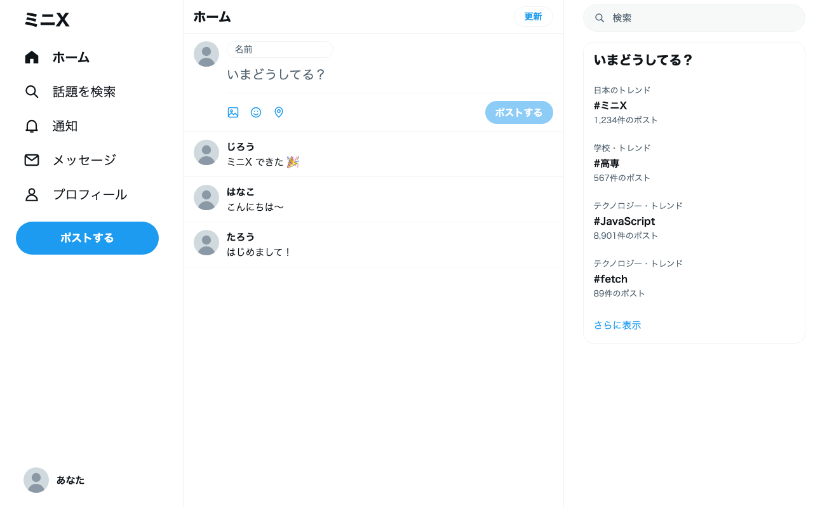
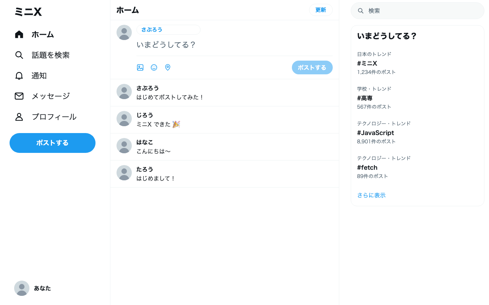

# ミニX をつくろう 手元資料

X 風のタイムラインアプリ「ミニX」を、2 日間で作ります。
この資料には、手を動かす手順をすべて書いています。前のスクリーンに映すスライドは要点だけなので、作業はこの資料を見ながら進めてください。

上から順に進めれば完成します。
スライドに「記述」が出たら、スライドのタイトルの番号（`0-1` など）と同じ番号の見出しを、この資料で探してください。見出しには、対応するスライドのページ番号も書いてあります。
各ミッションの最後には「動作チェック」があります。チェックが全部付いたら、次のミッションに進んでください。
動かないときは、その場で手を挙げるか、最後の「[困ったときは](#困ったときは)」を見てください。

<details>
<summary>目次</summary>

- [今日作るもの](#今日作るもの)
- [準備：自分の PC でミニX を開く](#準備自分の-pc-でミニx-を開く)
- [ミッション 0：HTML で X の画面を組み立てる](#ミッション-0html-で-x-の画面を組み立てる)
- [ミッション 1：配列のデータをタイムラインに並べる](#ミッション-1配列のデータをタイムラインに並べる)
- [ミッション 2：サーバーからみんなのポストを取ってくる](#ミッション-2サーバーからみんなのポストを取ってくる)
- [ミッション 3：自分のポストをサーバーに送る](#ミッション-3自分のポストをサーバーに送る)
- [ミッション 4：いいねを押せるようにする](#ミッション-4いいねを押せるようにする)
- [ミッション 5：自分だけの X にする](#ミッション-5自分だけの-x-にする)
- [応用ミッション](#応用ミッション)
- [困ったときは](#困ったときは)
- [用語集](#用語集)

</details>

## 今日作るもの

スライド：p.2〜3


自分のポストが、となりの人のタイムラインにも流れる SNS です。
見た目（CSS）は X に似せて用意してあります。みなさんが書くのは、画面の部品（HTML）と動き（JavaScript）です。

ポストを保存するサーバーとデータベースは、講師が用意しています。
みなさんの画面は、インターネットを通してそのサーバーとやりとりします。

| 日 | ミッション | 終わったときにできること |
| --- | --- | --- |
| 1 日目 | 準備 | 自分の PC でミニX が開く |
| | 0. HTML を書く | X の投稿欄が出る |
| | 1. 配列から並べる | 自分で書いたポストが並ぶ |
| 2 日目 | 2. サーバーから取る | みんなのポストが並ぶ |
| | 3. ポストする | 自分のポストがほかの人に届く |
| | 4. いいねする | いいねの数が増える |
| | 5. 自分の X にする | 好きな色とアイコンになる |

## 準備：自分の PC でミニX を開く

スライド：p.17〜21

**できるようになること**：自分の PC で Web アプリを作る準備が整う。エディタで書き、ターミナルで動かし、ブラウザで確かめる、という開発の流れが身につく。

### 手順

#### 準備 1. mini-x.zip をダウンロードして解凍する（スライド p.18）

まずは、今日使うファイル一式を手に入れます。

- [ ] 次のリンクから `mini-x.zip` をダウンロードする

  [mini-x.zip をダウンロード](https://github.com/jigintern/study_session_materials/raw/main/2026/mini-x/mini-x.zip)

- [ ] ダウンロードした `mini-x.zip` を解凍する。Mac はダブルクリック、Windows は右クリックして「すべて展開」を選びます。`mini-x` というフォルダができます

#### 準備 2. VS Code と Bun を入れる（スライド p.19）

次に、開発に使う道具を入れます。

- [ ] [Google Chrome](https://www.google.com/chrome/) が入っていなければ入れる
- [ ] [VS Code](https://code.visualstudio.com/) を入れる

**Bun**（バン）は、JavaScript をブラウザの外でも動かすための道具です。ふだん JavaScript はブラウザの中で動きますが、Bun があれば自分の PC の上で直接動かせます。
今日はまず、書いたページを手元で配る「開発サーバー」として使います。応用ミッションでは、サーバーを動かしたり、TypeScript や React をそのまま読み込んだりするのにも使います。
くわしい使い方は、[Bun の公式ドキュメント](https://bun.com/docs)にあります。

- [ ] ターミナルを開いて Bun を入れる

  Mac はアプリの「ターミナル」で、次を実行します。

  ```bash
  curl -fsSL https://bun.com/install | bash
  ```

  Windows は「PowerShell」で、次を実行します。

  ```powershell
  powershell -c "irm bun.sh/install.ps1|iex"
  ```

- [ ] **ターミナルを一度閉じて、開き直す**。開き直さないと、入れたばかりの Bun が見つかりません
- [ ] `bun --version` と打って、`1.4.3` のような数字が出ることを確かめる

#### 準備 3. ミニX を開く（スライド p.20）

- [ ] VS Code の「ファイル」→「フォルダーを開く」で、解凍した `mini-x` フォルダを開く。ファイルを 1 つだけ開くのではなく、フォルダごと開きます
- [ ] 「このフォルダー内のファイルの作成者を信頼しますか？」と聞かれたら、「はい、作成者を信頼します」を押す

  `mini-x` フォルダには、VS Code の設定（`.vscode/settings.json`）が入っています。ブラウザに切り替えるなどして VS Code から離れると、ファイルが自動で保存され、コードの字下げも自動で整います。`Cmd + S`（Windows は `Ctrl + S`）で自分で保存しても同じです。
- [ ] VS Code の「ターミナル」→「新しいターミナル」を開き、次を実行する

  ```bash
  bun run index.html
  ```

- [ ] ターミナルに表示された `http://localhost:3000/` のような URL を、Chrome で開く

#### 準備 4. Chrome の開発者ツールを開く（スライド p.21）

- [ ] Chrome で `F12`（Mac は `Cmd + Option + I`）を押して開発者ツールを開く
- [ ] 上のタブから **Console** を選び、場所を覚える。エラーはここに赤い字で出ます

### 動作チェック


- [ ] 左にメニュー、右に「いまどうしてる？」の欄がある画面が開いた
- [ ] 真ん中が空っぽになっている

真ん中は、これからみなさんが作る場所です。

### 詰まったとき

- `mini-x` フォルダが見つからない：ダウンロードした zip は、ふつう「ダウンロード」フォルダに入っています。zip のまま開いていないか確かめ、解凍してからフォルダを開いてください
- `bun: command not found` と出る：ターミナルを閉じて開き直してください。それでも出る場合は、Bun を入れるコマンドをもう一度実行します
- 画面が真っ白で、左右のメニューも出ない：VS Code でフォルダを開いているか、`index.html` のあるフォルダでコマンドを打ったかを確かめてください

## ミッション 0：HTML で X の画面を組み立てる

スライド：p.22〜30

**できるようになること**：見たことのある画面を部品に分けて、HTML で書ける。`id` と `class` で部品に名前を付けると、CSS がその名前を頼りに見た目を当てることが分かる。

### 考え方

X のホーム画面は、次の 4 つの部品でできています。

1. ヘッダー：上の「ホーム」の見出し
2. 投稿欄：アイコン、本文の入力欄、「ポストする」ボタン
3. 投稿カード：ポスト 1 件分。アイコン、名前、本文
4. タイムライン：投稿カードを縦に並べたもの


③ の投稿カードはポスト 1 件分です。④ のタイムラインは、そのカードを縦に並べた入れ物です。

HTML では、部品をタグで作ります。`<h1>ホーム</h1>` のように、`<タグ名>` で始めて `</タグ名>` で閉じます。

タグには名前を付けられます。

- `id="..."` は部品の名札で、ページの中に 1 つだけです。JavaScript が部品を探すときに使います
- `class="..."` は見た目の種類で、何個でも付けられます。CSS はこの名前で色や形を決めます

この資料のとおりに `class` を付けると、用意してある `styles.css` が当たって X の見た目になります。

ミッション 0 で使うタグは、次の 12 個です。

| タグ | 何のタグか | ミニX のどこで使うか |
| --- | --- | --- |
| `<header>` | ページや部品の見出しのまとまり | ① ヘッダー全体 |
| `<h1>` | いちばん大きな見出し | 「ホーム」の文字 |
| `<div>` | 意味を持たない入れ物。部品をまとめて `class` を付けるのに使う | ② 投稿欄の全体、本文のまとまり |
| `` | 画像を出す。閉じタグは書かない | アイコン |
| `<input>` | 1 行の入力欄。閉じタグは書かない | 名前の欄 |
| `<textarea>` | 何行も書ける入力欄 | 本文の欄 |
| `<button>` | 押せるボタン | 「ポストする」ボタン |
| `<ul>` | 並べたもののまとまり（リスト） | ④ タイムライン |
| `<li>` | リストの中の 1 項目。`<ul>` の中に入れる | ③ 投稿カード 1 枚 |
| `<span>` | 文の一部を囲む小さな入れ物 | カードの名前 |
| `<p>` | 文章のまとまり（段落） | カードの本文 |
| `<template>` | 画面に出ない見本。JavaScript がコピーして使う | 投稿カードの見本 |

タグの中には、`id` と `class` のほかにも、部品の設定を書けます。これを **属性** と呼びます。

| 属性 | 意味 | 使う例 |
| --- | --- | --- |
| `id` | 部品の名札。ページの中で 1 つだけ | `<button id="post-btn">` |
| `class` | 見た目の種類。何個でも付けられる | `<div class="compose">` |
| `src` | 出す画像のファイル | `` |
| `alt` | 画像が出ないときに代わりに読まれる文字。飾りの画像は空にする | `` |
| `type` | 入力欄の種類。`text` はふつうの文字 | `<input type="text">` |
| `placeholder` | 入力欄が空のときに薄く出る文字 | `placeholder="名前"` |

### 手順

#### 0-1. ヘッダーと投稿欄を書く（スライド p.26）

`index.html` を開き、`<main>` の中にある `<!-- ここから下に書いていきます -->` の下に書きます。

```html
<header class="header">
  <h1>ホーム</h1>
</header>

<div class="compose">
  
  <div class="compose-body">
    <input id="name-input" type="text" placeholder="名前">
    <textarea id="text-input" placeholder="いまどうしてる？"></textarea>
    <button id="post-btn">ポストする</button>
  </div>
</div>
```

保存すると、ブラウザに「ポストする」ボタンの投稿欄が出ます。
ボタンは、本文を入れるまで薄い青で表示されます。X と同じ見た目にしてあるだけなので、押すこと自体はできます。

#### 0-2. タイムラインと投稿カードを書く（スライド p.27）

0-1 で書いた投稿欄の下に、タイムラインと投稿カードを 1 枚だけ書きます。

```html
<ul id="timeline">
  <li class="post">
    
    <div class="post-body">
      <span class="name">たろう</span>
      <p class="text">はじめまして！</p>
    </div>
  </li>
</ul>
```

投稿欄の下に、ポストが 1 件出ます。X の投稿 1 件は、アイコン・名前・本文の 3 つの部品でできていることが分かります。

#### 0-3. 投稿カードを template に移す（スライド p.29）

ポストが何件あるかは、開くまで分かりません。カードを手で何枚も書くわけにはいかないので、カードを 1 枚だけ見本として置いておき、JavaScript にそれをコピーさせて、必要な枚数を作ります。
見本を置くには `<template>` を使います。`<template>` の中身は画面に出ず、JavaScript にコピーされるのを待ちます。

`<li>` を `<ul>` の外に出して `<template>` で包み、名前と本文を空にします。

```html
<ul id="timeline"></ul>

<template id="post-template">
  <li class="post">
    
    <div class="post-body">
      <span class="name"></span>
      <p class="text"></p>
    </div>
  </li>
</template>
```

保存するとカードが画面から消えます。これで正解です。

### 動作チェック


- [ ] 「ホーム」の見出しと、青い「ポストする」ボタンの投稿欄が出ている
- [ ] 投稿欄の下が空っぽになっている

### 詰まったとき

- 見た目が崩れる：閉じタグ（`</div>` など）が足りないか、`class` のつづりが違うことがほとんどです。資料のコードと 1 文字ずつ見比べてください
- アイコンが出ない：`src="icon.svg"` のつづりを確かめてください

### ここまでのコード

<details>
<summary><code>index.html</code> の <code>&lt;main&gt;</code> の中身</summary>

<!-- snapshot: m0 main -->
```html
<header class="header">
  <h1>ホーム</h1>
</header>

<div class="compose">
  
  <div class="compose-body">
    <input id="name-input" type="text" placeholder="名前">
    <textarea id="text-input" placeholder="いまどうしてる？"></textarea>
    <button id="post-btn">ポストする</button>
  </div>
</div>

<ul id="timeline"></ul>

<template id="post-template">
  <li class="post">
    
    <div class="post-body">
      <span class="name"></span>
      <p class="text"></p>
    </div>
  </li>
</template>
```

</details>

## ミッション 1：配列のデータをタイムラインに並べる

スライド：p.31〜40

**できるようになること**：データを配列とオブジェクトで表し、JavaScript で HTML の中身を書き換えられる。一覧の画面は「同じ見本をコピーして、違うデータを入れる」くり返しでできていると分かる。

### 考え方

データと画面は別のものです。
ポスト 1 件分のデータは `{ name: 'たろう', text: 'はじめまして！' }` のように `{ }` でまとめます。これを **オブジェクト** と呼びます。
オブジェクトを `[ ]` で並べたものが **配列** です。

JavaScript は、配列から 1 件ずつデータを取り出し、見本のカードをコピーして名前と本文を流し込み、タイムラインに入れます。
データが 1 件増えれば、カードも 1 枚増えます。

### 手順

#### 1-1. ポストのデータを配列で書く（スライド p.34）

`script.js` を開き、いちばん下に書きます。

```javascript
const posts = [
  { name: 'たろう', text: 'はじめまして！' },
  { name: 'はなこ', text: 'こんにちは〜' },
  { name: 'じろう', text: 'ミニX できた 🎉' },
];

console.log(posts);
```

Chrome の Console に `(3) [{…}, {…}, {…}]` と出ます。左の三角を押すと中身が開きます。
`posts[0]` は 1 件目、`posts[0].name` は 1 件目の名前 `'たろう'` です。数えるときは 0 から始まります。

#### 1-2. 1 件だけ画面に出す（スライド p.36）

`console.log(posts);` の下に、1 件だけ画面に出す関数を書きます。

```javascript
function showPosts() {
  const timeline = document.getElementById('timeline');
  const template = document.getElementById('post-template');

  const card = template.content.cloneNode(true);
  card.querySelector('.name').textContent = posts[0].name;
  card.querySelector('.text').textContent = posts[0].text;
  timeline.appendChild(card);
}

showPosts();
```

タイムラインに「たろう」のカードが 1 枚出ます。1 行ずつの意味は次のとおりです。

| 書き方 | 意味 |
| --- | --- |
| `document.getElementById('timeline')` | `id` が `timeline` の部品を探す |
| `template.content.cloneNode(true)` | 見本のカードをコピーする |
| `card.querySelector('.name')` | コピーしたカードの中から、`class` が `name` の部品を探す。`.` を付け忘れると見つからない |
| `部品.textContent = ...` | 部品の中の文字を書き換える |
| `timeline.appendChild(card)` | タイムラインの中にカードを入れる |
| `showPosts();` | 関数を呼び出す。書いただけでは動かず、呼んだときに中身が動く |

#### 1-3. 全件を並べる（スライド p.38）

`for (const post of posts) { }` は、配列から 1 件ずつ取り出して、`{ }` の中身をくり返します。1 周目は `post` に 1 件目が入り、2 周目は 2 件目が入ります。
カードを作る 4 行を `for` で包み、`posts[0]` を `post` に変えます。`for` の前に `timeline.textContent = '';` を足して、並べる前にタイムラインを空にします。

```javascript
function showPosts() {
  const timeline = document.getElementById('timeline');
  const template = document.getElementById('post-template');
  timeline.textContent = '';

  for (const post of posts) {
    const card = template.content.cloneNode(true);
    card.querySelector('.name').textContent = post.name;
    card.querySelector('.text').textContent = post.text;
    timeline.appendChild(card);
  }
}
```

カードが 3 枚並びます。

#### 1-4. 4 件目を自分で足す（スライド p.39）

`posts` の中に、自分の名前と好きな本文で 1 行足します。

```javascript
const posts = [
  { name: 'たろう', text: 'はじめまして！' },
  { name: 'はなこ', text: 'こんにちは〜' },
  { name: 'じろう', text: 'ミニX できた 🎉' },
  { name: 'さぶろう', text: '自分で足した 4 件目' },
];
```

保存すると、カードが 4 枚に増えます。

### 動作チェック


- [ ] カードが 4 枚並んでいる
- [ ] 4 枚目に、自分で足した名前と本文が出ている

ここまでできたら 1 日目は完了です。

### 詰まったとき

- カードが 1 枚も出ない：`showPosts();` を書き忘れていないか確かめてください。関数は呼ばないと動きません
- Console に `Uncaught SyntaxError` と出る：括弧 `( ) { } [ ]` やクォート `'` の閉じ忘れです。エラーの右端にある行番号の近くを見てください
- Console に `Cannot set properties of null` と出る：`querySelector` や `getElementById` で部品が見つかっていません。`'.name'` の `.` や、`id` のつづりを確かめてください

### ここまでのコード

<details>
<summary><code>index.html</code> の <code>&lt;main&gt;</code> の中身（ミッション 0 と同じ）</summary>

<!-- snapshot: m1 main -->
```html
<header class="header">
  <h1>ホーム</h1>
</header>

<div class="compose">
  
  <div class="compose-body">
    <input id="name-input" type="text" placeholder="名前">
    <textarea id="text-input" placeholder="いまどうしてる？"></textarea>
    <button id="post-btn">ポストする</button>
  </div>
</div>

<ul id="timeline"></ul>

<template id="post-template">
  <li class="post">
    
    <div class="post-body">
      <span class="name"></span>
      <p class="text"></p>
    </div>
  </li>
</template>
```

</details>

<details>
<summary><code>script.js</code></summary>

<!-- snapshot: m1 script.js -->
```javascript
const API = 'http://localhost:8000';
const ROOM = 'sample';

const posts = [
  { name: 'たろう', text: 'はじめまして！' },
  { name: 'はなこ', text: 'こんにちは〜' },
  { name: 'じろう', text: 'ミニX できた 🎉' },
  { name: 'さぶろう', text: '自分で足した 4 件目' },
];

console.log(posts);

function showPosts() {
  const timeline = document.getElementById('timeline');
  const template = document.getElementById('post-template');
  timeline.textContent = '';

  for (const post of posts) {
    const card = template.content.cloneNode(true);
    card.querySelector('.name').textContent = post.name;
    card.querySelector('.text').textContent = post.text;
    timeline.appendChild(card);
  }
}

showPosts();
```

</details>

## ミッション 2：サーバーからみんなのポストを取ってくる

スライド：p.41〜47

**できるようになること**：サーバーが何をしているかを説明できる。`fetch` でサーバーからデータを取ってきて、画面に出せる。開発者ツールの Network タブで、やりとりがうまくいったかを自分で確かめられる。

### 考え方

いまのミニX のポストは、自分の `script.js` の中にしかありません。となりの人のポストは見えません。
そこで、配列を自分で書く代わりに、サーバーに「ポストをください」と頼んで、ポストの一覧をもらってきます。

`script.js` の 1〜2 行目にある `API` と `ROOM` が、頼みに行く先です。

- `API` はサーバーの場所（URL）です
- `ROOM` は部屋の名前です。同じ部屋の人どうしで、ポストが見えます

サーバーは、講師が事前にインターネット上に立てています。サーバーの URL（`API`）と部屋の名前（`ROOM`）は、当日に講師が伝えます。

### 手順

#### 2-1. サーバーの返事を Chrome で見る（スライド p.43）

まず `script.js` の `API` と `ROOM` を、講師が伝えた値に書き換えます。

次に、講師が伝えた `API` の値のうしろに `/posts?room=` と `ROOM` の値をつなげた URL を、Chrome のアドレスバーに貼ります。形は次のとおりです。

```text
（講師が伝える API の値）/posts?room=（講師が伝える部屋の名前）
```

講師が立てたサーバーに「ポストをください」と頼むので、その場でポストの一覧が返ってきます。

ポストの一覧が **JSON** という形で表示されます。ミッション 1 で書いた配列とほぼ同じ形で、新しいポストが先頭に来ています。
`id`（ポストの番号）、`likes`（いいねの数）、`createdAt`（ポストした時刻）も入っています。

#### 2-2. 配列をサーバーからの返事に置き換える（スライド p.45）

`script.js` の `const posts = [ ... ];` と `console.log(posts);` を消します。
そして `showPosts` の頭に `async` を付け、中の先頭に 2 行を足します。

```javascript
async function showPosts() {
  const res = await fetch(API + '/posts?room=' + ROOM);
  const posts = await res.json();

  const timeline = document.getElementById('timeline');
  const template = document.getElementById('post-template');
  timeline.textContent = '';

  for (const post of posts) {
    const card = template.content.cloneNode(true);
    card.querySelector('.name').textContent = post.name;
    card.querySelector('.text').textContent = post.text;
    timeline.appendChild(card);
  }
}
```

| 書き方 | 意味 |
| --- | --- |
| `fetch(URL)` | その URL のサーバーに頼む |
| `res.json()` | 返事の中身を、JavaScript の配列として取り出す |
| `await` | 返事が来るまで待つ。サーバーの返事には少し時間がかかる |
| `async` | 中で `await` を使う関数の頭に付ける |

カードを作る部分は、ミッション 1 から 1 行も変えていません。データの出どころが変わっただけです。

#### 2-3. 更新ボタンを付ける（スライド p.46）

`index.html` のヘッダーの `<h1>` の下に、更新ボタンを 1 行足します。

```html
<header class="header">
  <h1>ホーム</h1>
  <button id="reload-btn">更新</button>
</header>
```

`script.js` のいちばん下に、更新ボタンが押されたら `showPosts` を動かす 1 行を足します。

```javascript
document.getElementById('reload-btn').addEventListener('click', showPosts);
```

`addEventListener('click', 関数)` は「クリックされたら、この関数を動かして」と頼む命令です。

### 動作チェック



- [ ] サーバーにあるポストが、新しい順に並んでいる
- [ ] ほかの人や講師がポストしたあとに「更新」を押すと、そのポストが先頭に出る

### 詰まったとき

開発者ツールの **Network** タブを開いて、ページを再読み込みしてください。
`posts?room=...` という行が赤くなっていたら、サーバーとのやりとりが失敗しています。その行をクリックして **Response** を見ると、サーバーからのメッセージが読めます。

- 行が赤く、`Failed to fetch` と出る：`API` の URL が間違っているか、サーバーに届いていません。URL を 1 文字ずつ確かめてください
- Console に `await is only valid in async functions` と出る：`showPosts` の頭に `async` を付け忘れています
- カードが 1 枚も出ず、エラーも出ない：`const posts = await res.json();` の `await` を付け忘れていないか確かめてください

### ここまでのコード

<details>
<summary><code>index.html</code> の <code>&lt;main&gt;</code> の中身</summary>

<!-- snapshot: m2 main -->
```html
<header class="header">
  <h1>ホーム</h1>
  <button id="reload-btn">更新</button>
</header>

<div class="compose">
  
  <div class="compose-body">
    <input id="name-input" type="text" placeholder="名前">
    <textarea id="text-input" placeholder="いまどうしてる？"></textarea>
    <button id="post-btn">ポストする</button>
  </div>
</div>

<ul id="timeline"></ul>

<template id="post-template">
  <li class="post">
    
    <div class="post-body">
      <span class="name"></span>
      <p class="text"></p>
    </div>
  </li>
</template>
```

</details>

<details>
<summary><code>script.js</code></summary>

<!-- snapshot: m2 script.js -->
```javascript
const API = 'http://localhost:8000';
const ROOM = 'sample';

async function showPosts() {
  const res = await fetch(API + '/posts?room=' + ROOM);
  const posts = await res.json();

  const timeline = document.getElementById('timeline');
  const template = document.getElementById('post-template');
  timeline.textContent = '';

  for (const post of posts) {
    const card = template.content.cloneNode(true);
    card.querySelector('.name').textContent = post.name;
    card.querySelector('.text').textContent = post.text;
    timeline.appendChild(card);
  }
}

document.getElementById('reload-btn').addEventListener('click', showPosts);

showPosts();
```

</details>

## ミッション 3：自分のポストをサーバーに送る

スライド：p.48〜53

**できるようになること**：ボタンが押されたときに動く処理を書き、入力欄の中身をサーバーに送れる。取ってくる処理と送る処理がそろい、「書いたものが保存されて、ほかの人にも見えるアプリ」の仕組みがひと通り分かる。

### 考え方

ミッション 2 では、サーバーに「ください」と頼みました。今度は「このポストを保存して」と頼みます。
頼む命令は同じ `fetch` ですが、送るときは、頼み方と送る中身を 2 つ目の引数で渡します。

### 手順

#### 3-1. ボタンが押されたら動く関数を作る（スライド p.50）

`script.js` の `showPosts` の下に、ポストする関数を書きます。まずは入力欄の中身を Console に出すだけにします。

```javascript
async function addPost() {
  const name = document.getElementById('name-input').value;
  const text = document.getElementById('text-input').value;
  console.log(name, text);
}
```

`.value` は、入力欄に書かれている文字です。

`script.js` のいちばん下に、「ポストする」ボタンが押されたら `addPost` を動かす 1 行を足します。

```javascript
document.getElementById('post-btn').addEventListener('click', addPost);
```

名前と本文を入れて「ポストする」を押すと、Console にその中身が出ます。

#### 3-2. サーバーに送る（スライド p.51）

`console.log(name, text);` の行を、サーバーに送る処理と後片付けに置き換えます。

```javascript
async function addPost() {
  const name = document.getElementById('name-input').value;
  const text = document.getElementById('text-input').value;

  await fetch(API + '/posts?room=' + ROOM, {
    method: 'POST',
    headers: { 'Content-Type': 'application/json' },
    body: JSON.stringify({ name: name, text: text }),
  });

  document.getElementById('text-input').value = '';
  showPosts();
}
```

| 書き方 | 意味 |
| --- | --- |
| `method: 'POST'` | 「保存して」という頼み方。何も書かないと「ください」（GET）になる |
| `headers: { 'Content-Type': 'application/json' }` | 送る中身が JSON だと伝える |
| `body: JSON.stringify({ ... })` | 送る中身。オブジェクトを JSON の文字に変えて送る |
| `...value = ''` | 送り終わったら本文の欄を空にする |
| `showPosts();` | タイムラインを取り直して、自分のポストを表示する |

### 動作チェック



- [ ] 名前と本文を入れて「ポストする」を押すと、自分のポストがタイムラインの先頭に出る
- [ ] 本文の欄が空になる
- [ ] となりの人に「更新」を押してもらうと、その人の画面にも自分のポストが出る

### 詰まったとき

Network タブで `posts?room=...` の赤い行をクリックし、**Response** を読んでください。サーバーが理由を教えてくれます。

| Response に出るメッセージ | 原因 |
| --- | --- |
| `本文を入れてください` | 本文が空のまま押した |
| `名前を入れてください` | 名前が空のまま押した |
| `本文は140文字までです` | 本文が長すぎる |
| `名前は20文字までです` | 名前が長すぎる |
| `送るデータを JSON の文字にしてください（JSON.stringify を使います）` | `JSON.stringify` を書き忘れた |

ポストの名前と本文は `textContent` で画面に出しています。ほかの人が書いた文字を、HTML としてではなくただの文字として出すので、`<script>` のようなタグを書かれても画面が乗っ取られません。

### ここまでのコード

<details>
<summary><code>index.html</code> の <code>&lt;main&gt;</code> の中身（ミッション 2 と同じ）</summary>

<!-- snapshot: m3 main -->
```html
<header class="header">
  <h1>ホーム</h1>
  <button id="reload-btn">更新</button>
</header>

<div class="compose">
  
  <div class="compose-body">
    <input id="name-input" type="text" placeholder="名前">
    <textarea id="text-input" placeholder="いまどうしてる？"></textarea>
    <button id="post-btn">ポストする</button>
  </div>
</div>

<ul id="timeline"></ul>

<template id="post-template">
  <li class="post">
    
    <div class="post-body">
      <span class="name"></span>
      <p class="text"></p>
    </div>
  </li>
</template>
```

</details>

<details>
<summary><code>script.js</code></summary>

<!-- snapshot: m3 script.js -->
```javascript
const API = 'http://localhost:8000';
const ROOM = 'sample';

async function showPosts() {
  const res = await fetch(API + '/posts?room=' + ROOM);
  const posts = await res.json();

  const timeline = document.getElementById('timeline');
  const template = document.getElementById('post-template');
  timeline.textContent = '';

  for (const post of posts) {
    const card = template.content.cloneNode(true);
    card.querySelector('.name').textContent = post.name;
    card.querySelector('.text').textContent = post.text;
    timeline.appendChild(card);
  }
}

async function addPost() {
  const name = document.getElementById('name-input').value;
  const text = document.getElementById('text-input').value;

  await fetch(API + '/posts?room=' + ROOM, {
    method: 'POST',
    headers: { 'Content-Type': 'application/json' },
    body: JSON.stringify({ name: name, text: text }),
  });

  document.getElementById('text-input').value = '';
  showPosts();
}

document.getElementById('post-btn').addEventListener('click', addPost);
document.getElementById('reload-btn').addEventListener('click', showPosts);

showPosts();
```

</details>

## ミッション 4：いいねを押せるようにする

スライド：p.54〜59

**できるようになること**：どのデータに対する操作かを、`id` でサーバーに伝えられる。ボタンごとに違う値を渡すために、その場で小さな関数を作って渡す書き方が分かる。

### 考え方

いいねは、サーバーに「この 1 件のいいねを 1 増やして」と頼むことです。
どのポストかは、URL の中にポストの `id` を入れて伝えます。

```text
POST /posts/ポストのid/like?room=部屋の名前
```

サーバーが数を増やして保存するので、ほかの人の画面でも同じ数が見えます。

### 手順

#### 4-1. カードにいいねボタンを付ける（スライド p.56）

`index.html` の `<template>` の中、本文 `<p class="text">` の下に、いいねボタンを 1 行足します。

```html
<button class="like-btn"><span class="like-count"></span></button>
```

保存すると、カードの下にハートのボタンが出ます。

#### 4-2. いいねの数を出して、押せるようにする（スライド p.57）

`script.js` の `showPosts` の `for` の中、本文を入れる行の下に 4 行を足します。

```javascript
card.querySelector('.like-count').textContent = post.likes;
card.querySelector('.like-btn').addEventListener('click', function () {
  addLike(post.id);
});
```

1 行目は、いいねの数をハートの横に出します。
2〜4 行目は、ハートが押されたら、このポストの `id` で `addLike` を呼ぶように頼んでいます。

`addEventListener('click', addLike)` と書くと、どのポストのいいねかを渡せません。そこで「このポストの `id` で `addLike` を呼ぶ」という小さな関数をその場で作り、それを渡します。カードを 1 枚作るたびに、そのカード専用の関数ができます。

続けて、`addPost` の下に、いいねを頼む関数を書きます。

```javascript
async function addLike(id) {
  await fetch(API + '/posts/' + id + '/like?room=' + ROOM, { method: 'POST' });
  showPosts();
}
```

### 動作チェック


- [ ] ハートを押すと、そのポストの数字が 1 増える
- [ ] ページを再読み込みしても、数字は増えたまま

### 詰まったとき

- 数字が出ない：`<span class="like-count">` のつづりと、`'.like-count'` の `.` を確かめてください
- 押しても数字が変わらない：Network タブで `like?room=...` の行を見てください。行が無ければ `addEventListener` の行を、赤ければ URL のつなぎ方（`'/posts/' + id + '/like?room='`）を確かめてください

### ここまでのコード

ここまでで本編は完成です。

<details>
<summary><code>index.html</code> の <code>&lt;main&gt;</code> の中身</summary>

<!-- snapshot: m4 main -->
```html
<header class="header">
  <h1>ホーム</h1>
  <button id="reload-btn">更新</button>
</header>

<div class="compose">
  
  <div class="compose-body">
    <input id="name-input" type="text" placeholder="名前">
    <textarea id="text-input" placeholder="いまどうしてる？"></textarea>
    <button id="post-btn">ポストする</button>
  </div>
</div>

<ul id="timeline"></ul>

<template id="post-template">
  <li class="post">
    
    <div class="post-body">
      <span class="name"></span>
      <p class="text"></p>
      <button class="like-btn"><span class="like-count"></span></button>
    </div>
  </li>
</template>
```

</details>

<details>
<summary><code>script.js</code></summary>

<!-- snapshot: m4 script.js -->
```javascript
const API = 'http://localhost:8000';
const ROOM = 'sample';

async function showPosts() {
  const res = await fetch(API + '/posts?room=' + ROOM);
  const posts = await res.json();

  const timeline = document.getElementById('timeline');
  const template = document.getElementById('post-template');
  timeline.textContent = '';

  for (const post of posts) {
    const card = template.content.cloneNode(true);
    card.querySelector('.name').textContent = post.name;
    card.querySelector('.text').textContent = post.text;
    card.querySelector('.like-count').textContent = post.likes;
    card.querySelector('.like-btn').addEventListener('click', function () {
      addLike(post.id);
    });
    timeline.appendChild(card);
  }
}

async function addPost() {
  const name = document.getElementById('name-input').value;
  const text = document.getElementById('text-input').value;

  await fetch(API + '/posts?room=' + ROOM, {
    method: 'POST',
    headers: { 'Content-Type': 'application/json' },
    body: JSON.stringify({ name: name, text: text }),
  });

  document.getElementById('text-input').value = '';
  showPosts();
}

async function addLike(id) {
  await fetch(API + '/posts/' + id + '/like?room=' + ROOM, { method: 'POST' });
  showPosts();
}

document.getElementById('post-btn').addEventListener('click', addPost);
document.getElementById('reload-btn').addEventListener('click', showPosts);

showPosts();
```

</details>

## ミッション 5：自分だけの X にする

スライド：p.60〜61

**できるようになること**：CSS の値を書き換えて、見た目を自分好みにできる。「ここを変えるとこうなる」を自分で試せるようになり、家に帰ってからも改造を続ける入口になる。

時間が押していたら、このミッションは飛ばしてかまいません。

### 手順

#### 5-1. アクセントの色を変える（スライド p.61）

`styles.css` の先頭にある `--accent` の色を、好きな色に変えます。

```css
:root {
  --accent: #1d9bf0;
}
```

`#1d9bf0` を `#e0245e`（ピンク）や `#17bf63`（緑）に変えると、「ポストする」ボタンなどの色がまとめて変わります。
名前を付けて使い回すこの値を **CSS 変数** と呼びます。1 か所変えるだけで、同じ変数を使っているところが全部変わります。

#### 5-2. アイコンを差し替える（スライド p.61）

`icon.svg` を、自分の好きな画像に差し替えます。差し替えた画像のファイル名に合わせて、`src="..."` も書き換えます。

#### 5-3. 名前の初期値を入れる（スライド p.61）

名前の入力欄に `value="自分の名前"` を足して、毎回入力しなくて済むようにします。

```html
<input id="name-input" type="text" placeholder="名前" value="さぶろう">
```

#### 5-4. ダークモードにする（スライド p.61）

余裕があれば、`:root` の中の背景色と文字色を書き換えて、ダークモードにします。X のダークモードに近い色は次のとおりです。

```css
:root {
  --bg: #000000;
  --bg-sub: #16181c;
  --text: #e7e9ea;
  --text-sub: #71767b;
  --border: #2f3336;
}
```

### 動作チェック

- [ ] 色かアイコンを 1 つ以上、自分好みに変えられた

## 応用ミッション

スライド：p.62〜63

本編が早く終わった人向けです。好きなものから挑戦してください。
応用ミッションは 2 つの組に分かれています。

- **A 組**は、HTML と CSS だけでできるミッションです。JavaScript が苦手でも、見た目を大きく変えられます
- **B 組**は、JavaScript を使うミッションです。下に行くほど難しくなります

どのミッションにも答えを付けています。まずはヒントだけで挑戦し、詰まったら「答え」を開いてください。
A 組と B 組の答えを全部入れた完成形は [advanced/](./advanced/) にあります（B6、B10、B11 は除く）。

### A 組：HTML と CSS だけで見た目を変える

#### A1. アプリの名前を自分で決める

左上の「ミニX」と、ブラウザのタブに出る名前を、自分で決めた名前に変えます。

- ヒント：`index.html` の `<title>` と、`class="wordmark"` の `<div>` の文字を書き換えます

<details>
<summary>答え</summary>

書き換えるファイルは `index.html` です。2 か所を書き換えます。

**1 か所目**は、ファイルの上のほう、`<head>` の中にある `<title>` です。ブラウザのタブに出る名前になります。

書き換える前：

```html
<title>ミニX</title>
```

書き換えた後：

<!-- answer: advanced index.html -->
```html
<title>ミニタイムライン</title>
```

**2 か所目**は、`<nav class="sidebar-left">` のすぐ下にある `class="wordmark"` の `<div>` です。左のメニューのいちばん上に出る名前になります。

書き換える前：

```html
<div class="wordmark">ミニX</div>
```

書き換えた後：

<!-- answer: advanced index.html -->
```html
<div class="wordmark">ミニタイムライン</div>
```

</details>

#### A2. 投稿欄の言葉を変える

「いまどうしてる？」の文字と、「ポストする」ボタンの文字を、好きな言葉に変えます。

- ヒント：入力欄に薄く出ている文字は `placeholder` です

<details>
<summary>答え</summary>

書き換えるファイルは `index.html` です。ミッション 0 で書いた投稿欄（`<div class="compose">` の中）の 2 行を書き換えます。
VS Code で `Ctrl + F`（Mac は `Cmd + F`）を押し、`text-input` で検索すると見つけやすいです。

書き換える前：

```html
<textarea id="text-input" placeholder="いまどうしてる？"></textarea>
<button id="post-btn">ポストする</button>
```

書き換えた後：

<!-- answer: advanced index.html -->
```html
<textarea id="text-input" placeholder="今日のひとことをどうぞ"></textarea>
```

<!-- answer: advanced index.html -->
```html
<button id="post-btn">つぶやく</button>
```

`id` は変えないでください。JavaScript は `id` で部品を探しているので、変えるとポストできなくなります。
左のメニューにも「ポストする」ボタン（`class="nav-post-btn"`）がありますが、こちらは飾りなので変えなくてかまいません。

</details>

#### A3. デフォルトアイコンの色を変える

灰色の人型のアイコンを、好きな色にします。

- ヒント：`icon.svg` を VS Code で開くと、中身は文字で書かれた絵です。`fill="#cfd9de"` のような色の指定が 2 種類あります
- ヒント：色は `#` と 6 けたの英数字で書きます。「カラーコード」で検索すると、色と数字の対応表が見つかります

<details>
<summary>答え</summary>

書き換えるファイルは `icon.svg` です。`fill="..."` の色を 3 か所書き換えます。

- `<rect ...>` の `fill` は背景の色です。`#cfd9de`（薄い灰色）を書き換えます
- `<circle ...>` と `<path ...>` の `fill` は人型の頭と体の色です。どちらも `#8b98a5`（灰色）を、同じ色に書き換えます

書き換える前：

```svg
<svg xmlns="http://www.w3.org/2000/svg" viewBox="0 0 400 400">
  <rect width="400" height="400" fill="#cfd9de"/>
  <circle cx="200" cy="160" r="72" fill="#8b98a5"/>
  <path d="M64 400c0-82 61-140 136-140s136 58 136 140z" fill="#8b98a5"/>
</svg>
```

背景を水色、人型を濃い青に書き換えた後：

<!-- answer: advanced icon.svg -->
```svg
<svg xmlns="http://www.w3.org/2000/svg" viewBox="0 0 400 400">
  <rect width="400" height="400" fill="#b3e5fc"/>
  <circle cx="200" cy="160" r="72" fill="#1565c0"/>
  <path d="M64 400c0-82 61-140 136-140s136 58 136 140z" fill="#1565c0"/>
</svg>
```

アイコンは、投稿欄、タイムラインのカード、左下の「あなた」の 3 か所すべてで変わります。

</details>

#### A4. 投稿カードの見た目を変える

ポストを 1 枚ずつ、角の丸いカードのように見せます。

- ヒント：`styles.css` のいちばん下に、`.post { }` を足します。あとに書いたものほど優先されます
- ヒント：角の丸みは `border-radius`、影は `box-shadow`、まわりのすき間は `margin` です

<details>
<summary>答え</summary>

書き換えるファイルは `styles.css` です。ファイルのいちばん下までスクロールし、最後の `}` の次の行に、次のコードを足します。もとからある行は書き換えません。

<!-- answer: advanced styles.css -->
```css
.post {
  margin: 12px 16px;
  border: 1px solid var(--border);
  border-radius: 16px;
  box-shadow: 0 2px 8px rgba(0, 0, 0, 0.08);
}
```

ファイルの上のほうにも `.post { ... }` がありますが、CSS は同じ部品に対して後に書いたものが優先されます。いちばん下に足せば、上の指定を上書きできます。

</details>

#### A5. 右のトレンド欄を自分の話題にする

右側の「いまどうしてる？」に並ぶ話題を、自分のクラスで流行っていそうな話題に変えます。

- ヒント：`index.html` の `class="trend-name"` が話題の名前、その下の `class="trend-meta"` が件数です

<details>
<summary>答え</summary>

書き換えるファイルは `index.html` です。ファイルの下のほうにある `<aside class="sidebar-right">` の中に、`<div class="trend">` が 4 つ並んでいます。1 つの `<div class="trend">` が、トレンド欄の 1 件です。
上から 1 つ目と 2 つ目の、話題の名前（`trend-name`）と件数（2 つ目の `trend-meta`）を書き換えます。

書き換える前：

```html
<div class="trend">
  <span class="trend-meta">日本のトレンド</span>
  <span class="trend-name">#ミニX</span>
  <span class="trend-meta">1,234件のポスト</span>
</div>
<div class="trend">
  <span class="trend-meta">学校・トレンド</span>
  <span class="trend-name">#高専</span>
  <span class="trend-meta">567件のポスト</span>
</div>
```

書き換えた後：

<!-- answer: advanced index.html -->
```html
<div class="trend">
  <span class="trend-meta">日本のトレンド</span>
  <span class="trend-name">#好きな食べ物</span>
  <span class="trend-meta">345件のポスト</span>
</div>
<div class="trend">
  <span class="trend-meta">学校・トレンド</span>
  <span class="trend-name">#部活</span>
  <span class="trend-meta">120件のポスト</span>
</div>
```

1 つ目の `trend-meta`（「日本のトレンド」など）も、好きな言葉に変えてかまいません。

</details>

#### A6. アイコンとボタンの形を変える

丸いアイコンと丸いボタンを、角の丸い四角に変えます。

- ヒント：アイコンは `.avatar`、ポストするボタンは `#post-btn` です。どちらも `border-radius` で丸くしています

<details>
<summary>答え</summary>

書き換えるファイルは `styles.css` です。ファイルのいちばん下までスクロールし、最後の `}` の次の行に、次のコードを足します。A4 もやった人は、A4 で足したコードの下に足してください。

<!-- answer: advanced styles.css -->
```css
.avatar {
  border-radius: 8px;
}

#post-btn {
  border-radius: 8px;
}
```

`border-radius` は角の丸みの大きさです。数を大きくするほど丸くなり、`0` にすると角がとがった四角になります。

</details>

### B 組：JavaScript で動きを足す

#### B1. 本文の残りの文字数を表示する

本文の欄の下に「140」のような残りの文字数を出し、入力するたびに減らします。140 文字を超えたら赤くします。

- ヒント：入力欄の文字が変わったときは `'input'` イベントが起きます
- ヒント：文字数は `text.length` で数えられます。色は `部品.style.color = 'red'` で変えられます

<details>
<summary>答え</summary>

`index.html` の `#text-input` と `#post-btn` のあいだに 1 行足します。

<!-- answer: advanced index.html -->
```html
<span id="count">140</span>
```

`script.js` に、残りの文字数を出す関数を足します。

<!-- answer: advanced script.js -->
```javascript
function showCount() {
  const text = document.getElementById('text-input').value;
  const count = document.getElementById('count');
  count.textContent = 140 - text.length;
  if (text.length > 140) {
    count.style.color = 'red';
  } else {
    count.style.color = '';
  }
}
```

入力のたびに呼ぶ 1 行を、いちばん下のほうに足します。

<!-- answer: advanced script.js -->
```javascript
document.getElementById('text-input').addEventListener('input', showCount);
```

ポストして本文の欄を空にしたあとも 140 に戻したいので、`addPost` の中にも 1 行足します。プログラムで欄を空にしたときは、`'input'` イベントが起きないためです。

<!-- answer: advanced script.js -->
```javascript
document.getElementById('text-input').value = '';
showCount();
```

見た目を整えるなら、`styles.css` のいちばん下に足します。

<!-- answer: advanced styles.css -->
```css
#count {
  align-self: flex-end;
  margin-top: 8px;
  color: var(--text-sub);
  font-size: 13px;
}
```

</details>

#### B2. ポストした時刻を表示する

カードの名前の横に、ポストした時刻を出します。

- ヒント：サーバーの返事の `createdAt` に時刻が入っています
- ヒント：`new Date(post.createdAt).toLocaleTimeString()` で「12:34:56」の形になります

<details>
<summary>答え</summary>

`index.html` の `<template>` の中、名前の下に 1 行足します。

<!-- answer: advanced index.html -->
```html
<span class="name"></span>
<span class="time"></span>
```

`showPosts` の `for` の中に 1 行足します。

<!-- answer: advanced script.js -->
```javascript
card.querySelector('.time').textContent = new Date(post.createdAt).toLocaleTimeString();
```

時刻を名前の横に薄い色で出すなら、`styles.css` のいちばん下に足します。

<!-- answer: advanced styles.css -->
```css
.time {
  margin-left: 4px;
  color: var(--text-sub);
}
```

</details>

#### B3. `Ctrl + Enter` でポストできるようにする

X と同じように、本文の欄で `Ctrl + Enter`（Mac は `Cmd + Enter`）を押すとポストできるようにします。

- ヒント：キーが押されたときは `'keydown'` イベントが起きます
- ヒント：押されたキーは `event.key`、`Ctrl` が押されているかは `event.ctrlKey`、`Cmd` は `event.metaKey` で分かります

<details>
<summary>答え</summary>

`script.js` のいちばん下のほうに足します。

<!-- answer: advanced script.js -->
```javascript
document.getElementById('text-input').addEventListener('keydown', function (event) {
  if (event.key === 'Enter' && (event.ctrlKey || event.metaKey)) {
    addPost();
  }
});
```

</details>

#### B4. 10 秒ごとに自動で更新する

「更新」を押さなくても、新しいポストが流れてくるようにします。

- ヒント：`setInterval(関数, ミリ秒)` で、関数を一定の間隔で呼べます。10 秒は 10000 ミリ秒です

<details>
<summary>答え</summary>

`script.js` のいちばん下に足します。

<!-- answer: advanced script.js -->
```javascript
setInterval(showPosts, 10000);
```

</details>

#### B5. 自分の PC でサーバーを動かす

今日つないでいたサーバーを、自分で作って、自分の PC で動かします。画面とサーバーの両方が、自分の PC の中だけで動くようになります。

1. [completed/server.js](./completed/server.js) を開き、どんな処理が書いてあるか読む
2. それを参考に、`index.html` と同じフォルダに `server.js` を作る
3. `bun run index.html` を動かしているターミナルで `Ctrl + C` を押して止める
4. `script.js` の `API` を `http://localhost:8000` にする
5. ターミナルで次を実行する

   ```bash
   bun run server.js
   ```

6. 表示された `http://localhost:8000/` を Chrome で開く。ミニX の画面が出て、ポストすると自分のサーバーに保存される

- ヒント：まずは `/posts` の一覧を返す部分だけを作り、Chrome で `http://localhost:8000/posts?room=sample` を開いて確かめると進めやすくなります
- ヒント：`server.js` は、同じフォルダの `index.html` を読み込んで画面として配りつつ、`/posts` への頼みごとにも答えます。1 つのサーバーが、画面とデータの両方を受け持っています
- ヒント：同じ Wi-Fi にいる友達に、自分の PC の IP アドレスを使った URL を教えると、友達の画面からもつないでもらえます

答えは [completed/server.js](./completed/server.js) そのものです。

#### B6. TypeScript に書き換える

`script.js` を **TypeScript** に書き換えてみます。TypeScript は、JavaScript に「この変数には文字列が入る」のような **型** を書き足せる言語です。書き間違いを、動かす前にエディタが教えてくれるようになります。

1. `script.js` の名前を `script.ts` に変える
2. `index.html` の `<script type="module" src="script.js">` を `src="script.ts"` に変える
3. VS Code で `script.ts` を開く。赤い波線がいくつも出るので、マウスを乗せて理由を読む
4. 理由に合わせて型を書き足し、波線を 1 つずつ消す

Bun は TypeScript をそのまま読めるので、`bun run index.html` のままで動きます。

- ヒント：`'timeline' is possibly 'null'` や `Property 'value' does not exist on type 'HTMLElement'` は、TypeScript が「その部品が本当にあるか」「何の部品か」を知らないために出ます。`as HTMLInputElement` のように、何の部品かを教えると消えます
- ヒント：サーバーから届くポストの形は、`type Post = { id: string; name: string; ... };` のように書いておけます
- ヒント：`textContent` に入れられるのは文字だけです。いいねの数は `String(post.likes)` で文字にします
- ヒント：波線が全部消えたら、わざと `addLike(123)` と書いてみましょう。「数（number）は、文字（string）の場所に入れられません」という意味のエラーが出ます

<details>
<summary>答え</summary>

`index.html` の `<script>` を書き換えます。

<!-- answer: typescript index.html -->
```html
<script type="module" src="script.ts"></script>
```

`script.ts` の全文です。完成形の `script.js` と 1 行ずつ見比べると、足した型が分かります。

<!-- answer: typescript script.ts -->
```typescript
const API = 'http://localhost:8000';
const ROOM = 'sample';

type Post = {
  id: string;
  name: string;
  text: string;
  likes: number;
  createdAt: string;
};

async function showPosts(): Promise<void> {
  const res = await fetch(API + '/posts?room=' + ROOM);
  const posts: Post[] = await res.json();

  const timeline = document.getElementById('timeline') as HTMLUListElement;
  const template = document.getElementById('post-template') as HTMLTemplateElement;
  timeline.textContent = '';

  for (const post of posts) {
    const card = template.content.cloneNode(true) as DocumentFragment;
    (card.querySelector('.name') as HTMLSpanElement).textContent = post.name;
    (card.querySelector('.text') as HTMLParagraphElement).textContent = post.text;
    (card.querySelector('.like-count') as HTMLSpanElement).textContent = String(post.likes);
    (card.querySelector('.like-btn') as HTMLButtonElement).addEventListener('click', function () {
      addLike(post.id);
    });
    timeline.appendChild(card);
  }
}

async function addPost(): Promise<void> {
  const name = (document.getElementById('name-input') as HTMLInputElement).value;
  const text = (document.getElementById('text-input') as HTMLTextAreaElement).value;

  await fetch(API + '/posts?room=' + ROOM, {
    method: 'POST',
    headers: { 'Content-Type': 'application/json' },
    body: JSON.stringify({ name: name, text: text }),
  });

  (document.getElementById('text-input') as HTMLTextAreaElement).value = '';
  showPosts();
}

async function addLike(id: string): Promise<void> {
  await fetch(API + '/posts/' + id + '/like?room=' + ROOM, { method: 'POST' });
  showPosts();
}

(document.getElementById('post-btn') as HTMLButtonElement).addEventListener('click', addPost);
(document.getElementById('reload-btn') as HTMLButtonElement).addEventListener('click', showPosts);

showPosts();
```

型のチェックを厳しめにする設定 `tsconfig.json` を、`script.ts` と同じフォルダに置くと、VS Code の波線がこの答えと同じ基準で出ます。

<!-- answer: typescript tsconfig.json -->
```json
{
  "compilerOptions": {
    "lib": ["ESNext", "DOM"],
    "target": "ESNext",
    "module": "Preserve",
    "moduleDetection": "force",

    "moduleResolution": "bundler",
    "allowImportingTsExtensions": true,
    "verbatimModuleSyntax": true,
    "noEmit": true,

    "strict": true,
    "skipLibCheck": true,
    "noFallthroughCasesInSwitch": true,
    "noUncheckedIndexedAccess": true,
    "noImplicitOverride": true
  },
  "include": ["script.ts"]
}
```

答えのファイル一式は [typescript/](./typescript/) にあります。

</details>

#### B7. 人ごとに違うアイコンにする

全員同じ灰色のアイコンを、名前の頭文字と色で、人ごとに違うアイコンにします。

- ヒント：`<template>` の `` を、文字を入れられる `<div class="avatar initial"></div>` に変えます
- ヒント：名前の 1 文字目は `post.name[0]` で取り出せます。背景の色は `部品.style.backgroundColor` で変えられます
- ヒント：色を配列に並べておき、`post.name.charCodeAt(0)`（1 文字目の文字の番号）を色の数で割った余りで選ぶと、同じ名前の人はいつも同じ色になります

<details>
<summary>答え</summary>

`index.html` の `<template>` の中のアイコンを差し替えます。

<!-- answer: advanced index.html -->
```html
<div class="avatar initial"></div>
```

`script.js` の `ROOM` の下に、色の配列を足します。

<!-- answer: advanced script.js -->
```javascript
const colors = ['#1d9bf0', '#f91880', '#00ba7c', '#ffad1f', '#7856ff'];
```

`showPosts` の `for` の中、カードを複製した行の下に足します。

<!-- answer: advanced script.js -->
```javascript
const avatar = card.querySelector('.avatar');
avatar.textContent = post.name[0];
avatar.style.backgroundColor = colors[post.name.charCodeAt(0) % colors.length];
```

頭文字を白い太字で真ん中に出すため、`styles.css` のいちばん下に足します。

<!-- answer: advanced styles.css -->
```css
.initial {
  display: flex;
  align-items: center;
  justify-content: center;
  color: #ffffff;
  font-size: 18px;
  font-weight: 700;
}
```

</details>

#### B8. 自分がいいねしたハートをピンクにする

自分が押したいいねだけ、ハートと数をピンクにします。ページを再読み込みすると元に戻ってかまいません。

- ヒント：押したポストの `id` を、配列にためておきます。配列に入れるのは `配列.push(値)`、入っているかを調べるのは `配列.includes(値)` です
- ヒント：部品に `class` を足すのは `部品.classList.add('liked')` です。CSS で `.like-btn.liked` の色を変えます

<details>
<summary>答え</summary>

`script.js` の `ROOM` の下に、押したポストの `id` をためる配列を足します。

<!-- answer: advanced script.js -->
```javascript
const liked = [];
```

`addLike` の先頭で、押したポストの `id` を配列に入れます。

<!-- answer: advanced script.js -->
```javascript
async function addLike(id) {
  liked.push(id);
```

`showPosts` の `for` の中、いいねの数を入れた行の下に足します。

<!-- answer: advanced script.js -->
```javascript
if (liked.includes(post.id)) {
  card.querySelector('.like-btn').classList.add('liked');
}
```

`styles.css` のいちばん下に足します。ハートは文字の色で描いているので、`color` を変えるだけでハートと数の両方がピンクになります。

<!-- answer: advanced styles.css -->
```css
.like-btn.liked {
  color: var(--like);
}
```

</details>

#### B9. 更新ボタンなしで、すぐに届くようにする（SSE）

B4 では、10 秒ごとにサーバーへ取りに行きました。この方法を **ポーリング** と呼びます。ポーリングでは、新しいポストが届くまで最大 10 秒待ちます。

**SSE**（Server-Sent Events）を使うと、サーバーのほうから「ポストが増えたよ」と知らせてくれます。知らせが来たらすぐ取り直すので、待たずに届きます。
サーバーには、知らせを送る口 `/posts/events?room=部屋の名前` が用意してあります。

- ヒント：`new EventSource(URL)` で、知らせを送る口につなぎます
- ヒント：知らせが来ると `'message'` イベントが起きます。そのときに `showPosts` を呼びます

<details>
<summary>答え</summary>

`script.js` のいちばん下に足します。

<!-- answer: advanced script.js -->
```javascript
const source = new EventSource(API + '/posts/events?room=' + ROOM);
source.addEventListener('message', showPosts);
```

となりの人がポストしたり、いいねを押したりすると、すぐ自分の画面にも出ます。開発者ツールの Network タブで `events` の行を開くと、届いた知らせ（`changed`）が見えます。

</details>

#### B10. React（JSX）で書き直す

**React** は、画面を「部品（コンポーネント）」に分けて作るためのライブラリです。X のような実際の Web アプリでも広く使われています。
React では **JSX** という書き方で、JavaScript の中に HTML のような形で画面を書きます。本編で `<template>` を複製していたところが、JSX ではそのまま画面の形として書けます。

1. `mini-x` フォルダをまるごとコピーし、名前を `mini-x-react` にする。VS Code でそのフォルダを開き直す
2. `mini-x-react` フォルダに `package.json` という名前のファイルを作り、中身を `{}` の 2 文字だけにする
3. ターミナルで次を実行し、React を入れる

   ```bash
   bun add react react-dom
   ```

4. `index.html` の `<main>` の中身を全部消して `<main id="root"></main>` にする。`<script>` の `src` は `main.jsx` に変える
5. `main.jsx` を作り、React を `<main id="root">` につなぐ
6. `app.jsx` を作り、画面をコンポーネントとして書く
7. `bun run index.html` で開き、前と同じようにポストやいいねができることを確かめる

手順 2 は飛ばさないでください。`package.json` が無いと、`bun add` は親のフォルダをさかのぼって見つけた別の `package.json` に書き込んでしまいます。

- ヒント：画面を 3 つのコンポーネントに分けると、本編のコードと見比べやすくなります。全体の `App`、投稿欄の `Compose`、ポスト 1 件分の `PostCard` です
- ヒント：JSX では、HTML の `class` を `className` と書きます。`onClick={関数}` で、クリックされたときの処理を渡せます
- ヒント：`useState` で持った値を変えると、React がその部分の画面を描き直します。本編のように `textContent` を自分で書き換える必要はありません
- ヒント：最初に一覧を取ってくる処理は、`useEffect` の中で 1 回だけ呼びます
- ヒント：画像は `import icon from './icon.svg';` のように読み込んで、`src={icon}` と書きます

<details>
<summary>答え</summary>

`index.html` の `<main>` と `<script>` を書き換えます。

<!-- answer: jsx index.html -->
```html
<main id="root"></main>
```

<!-- answer: jsx index.html -->
```html
<script type="module" src="main.jsx"></script>
```

`main.jsx` の全文です。React を `<main id="root">` につなぐだけのファイルです。

<!-- answer: jsx main.jsx -->
```jsx
import { createRoot } from 'react-dom/client';
import { App } from './app';

createRoot(document.getElementById('root')).render(<App />);
```

`app.jsx` の全文です。本編の `showPosts`、`addPost`、`addLike` が、`App` の中にほぼそのまま入っています。

<!-- answer: jsx app.jsx -->
```jsx
import { useEffect, useState } from 'react';
import icon from './icon.svg';

const API = 'http://localhost:8000';
const ROOM = 'sample';

function PostCard(props) {
  return (
    <li className="post">
      
      <div className="post-body">
        <span className="name">{props.post.name}</span>
        <p className="text">{props.post.text}</p>
        <button
          className="like-btn"
          onClick={function () {
            props.onLike(props.post.id);
          }}
        >
          <span className="like-count">{props.post.likes}</span>
        </button>
      </div>
    </li>
  );
}

function Compose(props) {
  const [name, setName] = useState('');
  const [text, setText] = useState('');

  async function handlePost() {
    await props.onPost(name, text);
    setText('');
  }

  return (
    <div className="compose">
      
      <div className="compose-body">
        <input
          id="name-input"
          type="text"
          placeholder="名前"
          value={name}
          onChange={function (event) {
            setName(event.target.value);
          }}
        />
        <textarea
          id="text-input"
          placeholder="いまどうしてる？"
          value={text}
          onChange={function (event) {
            setText(event.target.value);
          }}
        />
        <button id="post-btn" onClick={handlePost}>
          ポストする
        </button>
      </div>
    </div>
  );
}

export function App() {
  const [posts, setPosts] = useState([]);

  async function showPosts() {
    const res = await fetch(API + '/posts?room=' + ROOM);
    const data = await res.json();
    setPosts(data);
  }

  async function addPost(name, text) {
    await fetch(API + '/posts?room=' + ROOM, {
      method: 'POST',
      headers: { 'Content-Type': 'application/json' },
      body: JSON.stringify({ name: name, text: text }),
    });
    showPosts();
  }

  async function addLike(id) {
    await fetch(API + '/posts/' + id + '/like?room=' + ROOM, { method: 'POST' });
    showPosts();
  }

  useEffect(function () {
    showPosts();
  }, []);

  const cards = [];
  for (const post of posts) {
    cards.push(<PostCard key={post.id} post={post} onLike={addLike} />);
  }

  return (
    <>
      <header className="header">
        <h1>ホーム</h1>
        <button id="reload-btn" onClick={showPosts}>
          更新
        </button>
      </header>
      <Compose onPost={addPost} />
      <ul id="timeline">{cards}</ul>
    </>
  );
}
```

答えのファイル一式は [jsx/](./jsx/) にあります。

</details>

#### B11. React 版を TypeScript（TSX）にする

B10 の React 版を、B6 と同じように TypeScript にします。JSX を TypeScript で書いたものを **TSX** と呼びます。

1. B10 の `mini-x-react` フォルダで、型の情報を入れる

   ```bash
   bun add -d @types/react @types/react-dom
   ```

2. `main.jsx` を `main.tsx` に、`app.jsx` を `app.tsx` に名前を変える。`index.html` の `src` も `main.tsx` にする
3. `tsconfig.json` と `bun-env.d.ts` を作る（中身は答えにあります）
4. VS Code で `app.tsx` を開き、赤い波線が消えるように型を書き足す

- ヒント：ポスト 1 件の形は、B6 と同じく `type Post = { ... };` で書けます
- ヒント：コンポーネントが受け取る値（props）の形も、`type PostCardProps = { ... };` のように書きます
- ヒント：`useState<Post[]>([])` と書くと、「ポストの配列を入れる箱」だと TypeScript に伝わります
- ヒント：`bun-env.d.ts` は、「`.svg` のファイルを読み込むと、画像の場所（文字）が手に入る」と TypeScript に教えるファイルです

<details>
<summary>答え</summary>

`index.html` の `<script>` を書き換えます。

<!-- answer: tsx index.html -->
```html
<script type="module" src="main.tsx"></script>
```

`main.tsx` の全文です。`getElementById('root')` の後ろの `!` は、「この部品は必ずある」と TypeScript に伝える印です。

<!-- answer: tsx main.tsx -->
```tsx
import { createRoot } from 'react-dom/client';
import { App } from './app';

createRoot(document.getElementById('root')!).render(<App />);
```

`app.tsx` では、ファイルの上のほうに型の定義を足します。

<!-- answer: tsx app.tsx -->
```tsx
type Post = {
  id: string;
  name: string;
  text: string;
  likes: number;
  createdAt: string;
};

type PostCardProps = {
  post: Post;
  onLike(id: string): void;
};

type ComposeProps = {
  onPost(name: string, text: string): Promise<void>;
};
```

そのうえで、B10 の `app.jsx` から次の行だけを書き換えます。

<!-- answer: tsx app.tsx -->
```tsx
function PostCard(props: PostCardProps) {
```

<!-- answer: tsx app.tsx -->
```tsx
function Compose(props: ComposeProps) {
```

<!-- answer: tsx app.tsx -->
```tsx
const [posts, setPosts] = useState<Post[]>([]);
```

<!-- answer: tsx app.tsx -->
```tsx
const data: Post[] = await res.json();
```

<!-- answer: tsx app.tsx -->
```tsx
async function addPost(name: string, text: string) {
```

<!-- answer: tsx app.tsx -->
```tsx
async function addLike(id: string) {
```

`tsconfig.json` の全文です。

<!-- answer: tsx tsconfig.json -->
```json
{
  "compilerOptions": {
    "lib": ["ESNext", "DOM"],
    "target": "ESNext",
    "module": "Preserve",
    "moduleResolution": "bundler",
    "jsx": "react-jsx",
    "strict": true,
    "noEmit": true
  }
}
```

`bun-env.d.ts` の全文です。

<!-- answer: tsx bun-env.d.ts -->
```typescript
declare module '*.svg' {
  const path: string;
  export default path;
}
```

答えのファイル一式は [tsx/](./tsx/) にあります。

</details>

## 困ったときは

動かないときは、まず Chrome の開発者ツールで **Console** を見てください。赤い字が出ていれば、右端のファイル名と行番号のあたりに間違いがあります。

| こうなった | まず確かめること |
| --- | --- |
| 直したのに画面が変わらない | ファイルが保存されているか。VS Code のタブの名前の横に ● が出ていたら未保存。ブラウザを再読み込みしたか |
| `bun: command not found` | ターミナルを閉じて開き直したか |
| 画面が真っ白 | `bun run index.html` を、`index.html` のあるフォルダで実行したか |
| `Uncaught SyntaxError` | 括弧 `( ) { } [ ]` やクォート `'` の閉じ忘れ |
| `Cannot set properties of null` | `getElementById` の `id` のつづり、`querySelector` の `.` の付け忘れ |
| `await is only valid in async functions` | 関数の頭に `async` を付けたか |
| `Failed to fetch` | `API` の URL が合っているか |
| Network タブの行が赤い | 行をクリックして Response のメッセージを読む |

## 用語集

| 用語 | 意味 |
| --- | --- |
| Web アプリケーション | ブラウザの中で動くアプリ。URL を開くだけで使える |
| クライアント | サービスを使う側。今日はみなさんのブラウザ |
| サーバー | 頼まれたものを渡したり、保存したりするコンピュータ |
| データベース | たくさんのデータを整理してしまっておく場所。今日はサーバーの中にある |
| HTML | 画面の部品と並びを書く言語 |
| CSS | 色や形などの見た目を決める言語 |
| JavaScript | 画面の動きや、サーバーとのやりとりを書く言語 |
| Bun | JavaScript をブラウザの外でも動かす道具。今日は開発サーバーとして使う |
| 開発サーバー | 書いたページを、自分の PC からブラウザに配るしくみ。`bun run index.html` で立ち上がる |
| `id` | 部品の名札。ページの中で 1 つだけ |
| `class` | 見た目の種類。何個でも付けられる |
| 配列 | `[ ]` でデータを並べたもの |
| オブジェクト | `{ }` で 1 件分のデータをまとめたもの |
| 関数 | 処理をまとめて名前を付けたもの。呼んだときに動く |
| JSON | サーバーとデータをやりとりするときの書き方。配列やオブジェクトとほぼ同じ形 |
| `fetch` | サーバーに頼む命令 |
| GET と POST | サーバーへの頼み方。GET は「ください」、POST は「保存して」 |
| 開発者ツール | Chrome に入っている、ページの中身やエラーを調べる道具。`F12` で開く |
