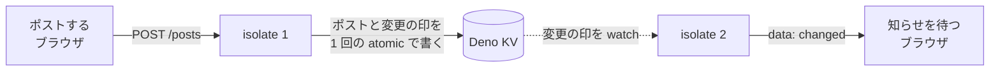

# ミニX API (講師用サーバー)

2026 年 11 月の高専訪問勉強会「ミニX をつくろう」で、講師がインターネット上に立てて受講者がつなぐサーバーです。
[completed/server.js](../completed/server.js) (Bun) と同じ API を返し、保存先を Deno KV にして Deno Deploy で動かします。



## エンドポイント

すべてのエンドポイントに `room` クエリパラメータが必要です。
英数字とハイフンで 1〜32 文字です。

- `GET /posts?room=sample`: その部屋のポストを新しい順に返す。はじめての部屋には、サンプルのポストを 3 件入れてから返す
- `POST /posts?room=sample`: `{"name": "たろう", "text": "こんにちは"}` を保存し、`201` と保存したポストを返す
- `POST /posts/:id/like?room=sample`: その id のポストのいいねを 1 増やし、ポストを返す
- `GET /posts/events?room=sample`: SSE でつないだままにし、その部屋のポストかいいねが変わるたびに `data: changed` を流す

ポストは次の形です。

```json
{
  "id": "01M5XG57H749JZNNTJ6EVEC0YW",
  "name": "たろう",
  "text": "こんにちは",
  "likes": 0,
  "createdAt": "2026-10-27T01:38:51.559Z"
}
```

`name` は 20 文字まで、`text` は 140 文字までです。
前後の空白を取り除いてから数え、空になったら `400` を返します。
文字数はコードポイント単位です (絵文字は 1 文字)。
1 つの部屋に残すのは 200 件までで、超えると古いものから消します。

エラーは `{"message": "..."}` の形で、受講者が読める日本語の文を返します。
ステータスと文面は completed/server.js と同じです。

## completed/server.js と異なる点

受講者から見た API は同じですが、次の点が異なります。

- `/` で画面を配信しない。受講者は手元で `bun run index.html` を実行して画面を開く
- ポストはサーバーを再起動しても残る
- id は UUID ではなく ULID。辞書順が作った順になるので、KV から並べ替えずに新しい順で読める
- Deno Deploy は何も流れない接続が続くと isolate を停止するので、SSE の接続に 15 秒ごとに `: ping` を流す
- サーバー側で例外が起きたときも、CORS ヘッダー付きの `500` を返す

Deno Deploy は isolate を複数立てるので、SSE の接続を持つ isolate と POST を受けた isolate が別になりえます。
ポストといいねのたびに KV の `["changed", room]` を書き換え、SSE の側はそれを `kv.watch` で監視します。

isolate をまたいで知らせが届くことは、手元では確かめていません。
ローカルの KV (SQLite) の watch は、ほかのプロセスが書いた変更を検知しませんでした。

## 開発

```sh
deno task dev     # http://localhost:8000 で起動
deno task test    # テスト (KV はメモリ上に作られる)
deno task check   # fmt / lint / 型チェック
```

`KV_PATH` を指定するとその場所の KV を使います。
指定しなければ既定の場所 (Deno Deploy 上では割り当てられた KV) です。

API が completed/server.js と同じであることは、[verify.mjs](../verify.mjs) が確かめます。
Bun 版にかけるのと同じ API の検査と、完成形と応用 B9 の画面をこのサーバーにつないだ検査を実行します。

## デプロイ

Deno Deploy に自分の組織を作ってから、[deploy.sh](./deploy.sh) を実行します。
組織は https://console.deno.com で作れます。
ログインしていなければ、最初のコマンドでブラウザが開きます。

```sh
./deploy.sh <組織名>                         # アプリ mini-x-2026 と KV mini-x-2026-kv を作る
./deploy.sh <組織名> <アプリ名> <KV の名前>  # 既存の KV を使う
```

アプリの作成、KV の割り当て、本番へのデプロイを順に実行します。
作成済みのものは省略するので、コードを直したあとの再デプロイにもそのまま使えます。
URL は `https://<アプリ名>.<組織名>.deno.net` になります。

無料プランでは、組織に作れる KV は 1 つまでです。
組織に KV がすでにあるときは、`deno deploy database list --org <組織名>` で名前を調べて 3 つめの引数に渡します。
1 つの KV を複数のアプリに割り当てても、アプリごとに別のデータベースが作られるので、データは混ざりません。

無料プランの利用上限を超えると、アプリは停止して `503` (`USAGE_EXCEEDED`) を返します。
別の組織にデプロイし直して URL を差し替えれば、使い続けられます。
ポストは引き継がれません。

`deno deploy` は `deno.json` に `deploy` の設定 (組織とアプリ) を書き込みます。
個人の組織名が入るので、コミットしないでください。
