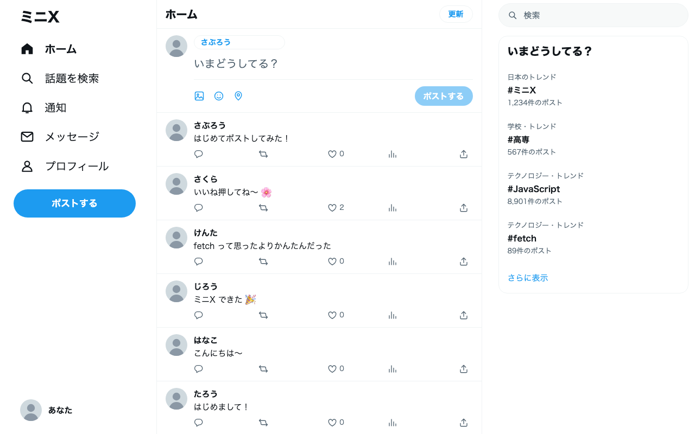
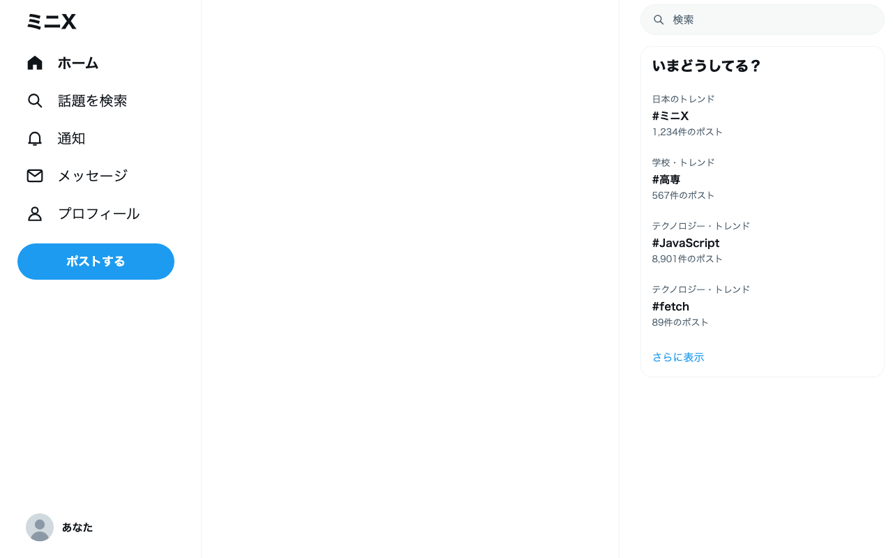
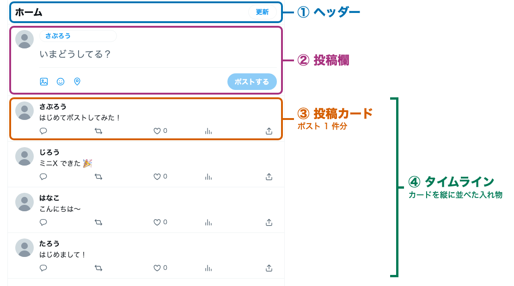
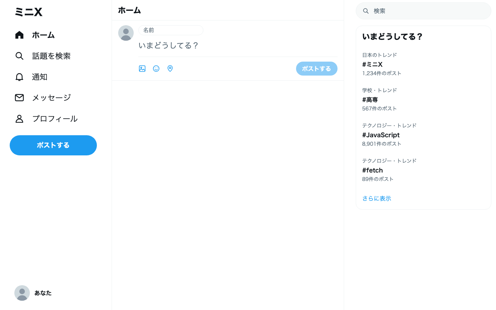
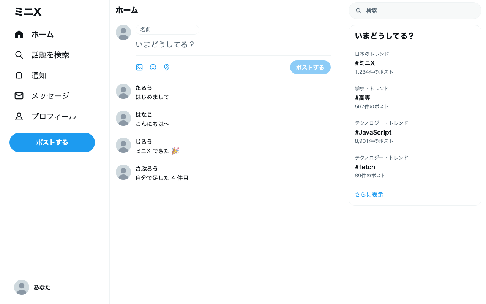

<!-- _class: lead -->

# **ミニX** をつくろう

## X 風のタイムラインを、HTML と JavaScript で作る 2 日間

---

## 今日のゴール

### 自分のポストが、<br>となりの人のタイムラインに流れる



- 名前と本文を書いて、ポストする
- 自分のポストが先頭に出る
- となりの人の画面にも出る
- いいねを押すと数が増える

見た目は X そっくりに用意済み。<br>動きは自分で書きます。

---

## 2 日間の流れ

| | やること | 終わったときの画面 |
|---|---|---|
| 1 日目 | Web アプリ概論 | （話を聞く） |
| | 準備 | 空の「ミニX」が開く |
| | ミッション 0：HTML を書く | 投稿欄が出る |
| | ミッション 1：配列から並べる | ポストが並ぶ |
| 2 日目 | ミッション 2：サーバーから取る | みんなのポストが並ぶ |
| | ミッション 3：ポストする | 自分のポストが届く |
| | ミッション 4：いいねする | いいねの数が増える |
| | ミッション 5：自分の X にする | 好きな色になる |

---

## 進め方

### 手元の資料を見ながら、自分のペースで進める

- 手を動かす手順は、すべて **手元資料（`DOCS.md`）** に書いてあります
- スライドでは、各ミッションの考え方と書くコードの要点を説明します
- 説明を聞いてから進めても、先に進めても大丈夫です
- 詰まったら手を挙げてください。講師が席まで行きます

---

<!-- _class: record -->

## スライドの見かた

### 右上に「記述」バッジ → 手を動かしてコードを書くスライド

**ハイライトあり** は、ハイライトの部分だけを書き足します。残りはそのままです。

```javascript
function addPost() {
  const name = document.getElementById('name-input').value;
  @@const text = document.getElementById('text-input').value;@@
}
```

**ハイライトなし** は、コードをそのまま写します。

タイトルの番号（`0-1` など）は、手元資料の見出しの番号と同じです。

---

<!-- _class: lead -->

# Web アプリケーション概論

## そもそも、いま何を作ろうとしているのか

---

## Web アプリケーションとは

### ブラウザの中で動くアプリのこと

- ブラウザは Chrome、Safari、Edge など、Web ページを開くためのアプリ
- スマホのアプリは、ストアからインストールしてから使う
- Web アプリは、URL を開くだけで使える。インストールは要らない

開くたびにサーバーから届くので、いつでも最新の状態で使えます。

---

## Web サイトとのちがい

### 読むだけか、自分で操作できるか

| | Web サイト | Web アプリケーション |
|---|---|---|
| 例 | 学校のホームページ、ニュース | X、YouTube、Google マップ |
| できること | 書いてあることを読む | 書く、送る、検索する、保存する |
| 画面 | 誰が見ても同じ | 人や操作によって変わる |

X は、自分でポストを書き、ほかの人のポストにいいねを押せます。<br>だから X は Web アプリケーションです。

---

## 身近な Web アプリケーション

### 毎日使っているものの多くが Web アプリケーション

- **動画配信**：YouTube。見る、コメントする、高評価する
- **ネットショップ**：Amazon。探す、カートに入れる、買う
- **地図**：Google マップ。検索する、道順を調べる
- **SNS**：X。ポストする、いいねする、フォローする

どれも、操作した内容が保存され、ほかの人にも見えます。

---

## Web アプリケーションの 3 つの役割

<div class="roles">
<div class="role view"><b>画面</b>ボタンや入力欄を見せる<br>操作を受け取る</div>
<div class="role logic"><b>処理</b>中身を確かめる<br>どうするか決める</div>
<div class="role store"><b>保存</b>ポストやいいねの数を<br>覚えておく</div>
</div>

X でポストを 1 件送るだけでも、この 3 つが順番に働いています。

---

## 3 つの役割は、2 つの場所に分かれている

<div class="scene">
<div class="place">
<svg viewBox="0 0 260 200" aria-label="スマホとパソコンを使う人">
  <rect x="0" y="176" width="260" height="4" fill="#cfd9de"/>
  <rect x="14" y="88" width="120" height="76" rx="6" fill="#e8f1fb" stroke="#1d6fd1" stroke-width="4"/>
  <rect x="28" y="102" width="60" height="8" rx="4" fill="#1d6fd1"/>
  <rect x="28" y="118" width="92" height="6" rx="3" fill="#9cc0ea"/>
  <rect x="28" y="132" width="80" height="6" rx="3" fill="#9cc0ea"/>
  <rect x="28" y="146" width="88" height="6" rx="3" fill="#9cc0ea"/>
  <polygon points="2,164 146,164 158,176 -10,176" fill="#1d6fd1"/>
  <circle cx="206" cy="52" r="24" fill="#f2c9a0"/>
  <path d="M206 28 a24 24 0 0 1 24 22 h-48 a24 24 0 0 1 24 -22z" fill="#3b3b3b"/>
  <rect x="176" y="82" width="60" height="94" rx="26" fill="#1d6fd1"/>
  <rect x="160" y="96" width="30" height="50" rx="6" fill="#1f2a36"/>
  <rect x="164" y="102" width="22" height="38" rx="3" fill="#e8f1fb"/>
  <circle cx="186" cy="136" r="9" fill="#f2c9a0"/>
</svg>
<b class="client">クライアント</b>
<span>人が触って使う場所<br>みんなの手元のスマホや PC</span>
<span>担当：画面</span>
</div>
<div class="place">
<svg viewBox="0 0 220 200" aria-label="インターネットでつながる長い道のり">
  <defs><marker id="arrowhead" viewBox="0 0 10 10" refX="8" refY="5" markerWidth="6" markerHeight="6" orient="auto-start-reverse"><path d="M0 0L10 5L0 10z" fill="#8a96a3"/></marker></defs>
  <circle cx="84" cy="92" r="26" fill="#eef2f5" stroke="#8a96a3" stroke-width="3"/>
  <circle cx="116" cy="76" r="32" fill="#eef2f5" stroke="#8a96a3" stroke-width="3"/>
  <circle cx="148" cy="94" r="24" fill="#eef2f5" stroke="#8a96a3" stroke-width="3"/>
  <rect x="78" y="94" width="76" height="24" fill="#eef2f5"/>
  <line x1="62" y1="118" x2="170" y2="118" stroke="#8a96a3" stroke-width="3"/>
  <line x1="8" y1="160" x2="212" y2="160" stroke="#8a96a3" stroke-width="4" stroke-dasharray="10 9" marker-start="url(#arrowhead)" marker-end="url(#arrowhead)"/>
</svg>
<b>インターネット</b>
<span>遠く離れていても<br>頼みごとと返事がすぐ届く</span>
</div>
<div class="place">
<svg viewBox="0 0 260 200" aria-label="コンピュータとデータベースが並ぶ建物">
  <polygon points="10,48 130,12 250,48" fill="#2c6b4f"/>
  <rect x="18" y="48" width="224" height="136" fill="#f3f7f5" stroke="#2c6b4f" stroke-width="4"/>
  <rect x="34" y="64" width="40" height="112" rx="4" fill="#2c6b4f"/>
  <rect x="84" y="64" width="40" height="112" rx="4" fill="#2c6b4f"/>
  <rect x="134" y="64" width="40" height="112" rx="4" fill="#2c6b4f"/>
  <g fill="#9fe3b9">
    <rect x="40" y="74" width="28" height="10" rx="2"/><rect x="40" y="94" width="28" height="10" rx="2"/><rect x="40" y="114" width="28" height="10" rx="2"/><rect x="40" y="134" width="28" height="10" rx="2"/><rect x="40" y="154" width="28" height="10" rx="2"/>
    <rect x="90" y="74" width="28" height="10" rx="2"/><rect x="90" y="94" width="28" height="10" rx="2"/><rect x="90" y="114" width="28" height="10" rx="2"/><rect x="90" y="134" width="28" height="10" rx="2"/><rect x="90" y="154" width="28" height="10" rx="2"/>
    <rect x="140" y="74" width="28" height="10" rx="2"/><rect x="140" y="94" width="28" height="10" rx="2"/><rect x="140" y="114" width="28" height="10" rx="2"/><rect x="140" y="134" width="28" height="10" rx="2"/><rect x="140" y="154" width="28" height="10" rx="2"/>
  </g>
  <rect x="186" y="104" width="44" height="64" fill="#e0efe7" stroke="#2c6b4f" stroke-width="3"/>
  <ellipse cx="208" cy="168" rx="22" ry="8" fill="#e0efe7" stroke="#2c6b4f" stroke-width="3"/>
  <rect x="187" y="150" width="42" height="18" fill="#e0efe7"/>
  <path d="M186 136 a22 8 0 0 0 44 0" fill="none" stroke="#2c6b4f" stroke-width="3"/>
  <ellipse cx="208" cy="104" rx="22" ry="8" fill="#c7e3d3" stroke="#2c6b4f" stroke-width="3"/>
</svg>
<b class="server">サーバー</b>
<span>コンピュータとデータベースが<br>ずらりと並ぶ建物の中にある</span>
<span>担当：処理と保存</span>
</div>
</div>

クライアントは目の前にあり、サーバーは遠くの建物にあります。<br>2 つはインターネットでつながっています。

---

## X でポストしたとき

<div class="flow">
  <div class="box">自分のブラウザ<span class="note">本文を書いて送る</span></div>
  <div class="arrow">→</div>
  <div class="box sub">サーバー<span class="note">確かめて保存する</span></div>
  <div class="arrow">→</div>
  <div class="box">となりの人のブラウザ<span class="note">取りに来て表示する</span></div>
</div>

- 保存はサーバーの中で、**データベース** が担当します
- データベースは、たくさんのデータを整理してしまっておく場所です
- サーバーに保存されるので、ほかの人も同じポストを取りに来られます

---

## もし、保存が自分のブラウザの中だけだったら

### 自分にしか見えない。ページを閉じたら消える

- ポストは自分の PC の中にしかないので、となりの人は取りに行けない
- ブラウザを閉じると、書いたものが全部なくなる

みんなで見られるのは、ポストがサーバーに集まっているからです。<br>だから画面とサーバーを分けて作ります。

---

## 今日作るミニX の分担

<div class="flow">
  <div class="box">画面<span class="note">HTML・CSS・JavaScript</span><span class="note"><b>みなさんが書く</b></span></div>
  <div class="arrow">⇄</div>
  <div class="box sub">サーバーとデータベース<span class="note">ポストといいねを保存する</span><span class="note"><b>講師が用意済み</b></span></div>
</div>

| 言語 | 役割 | 今日 |
|---|---|---|
| HTML | 画面の部品と並び | 書く |
| CSS | 色や形などの見た目 | 用意済み。最後に少しいじる |
| JavaScript | 動き。サーバーとのやりとり | 書く |

---

## 使う道具は 3 つ

| 道具 | 役割 |
|---|---|
| **VS Code** | コードを書くエディタ |
| **Bun** | 書いたページを手元で動かす（開発サーバー） |
| **Chrome** | 動いた画面を確かめる。エラーもここで見る |

この 3 つは、プロのエンジニアも毎日使っている道具です。<br>家に帰ってからも、同じ手順で続きが作れます。

---

## Bun とは

### JavaScript を、ブラウザの外でも動かすための道具

- ブラウザの中で動く JavaScript を、自分の PC の上でも動かせる。<br>サーバーも JavaScript で書ける
- 同じ役割の道具に Node.js がある。<br>Bun はより新しく、1 つで何役もこなす

| コマンド | この教材での使いみち |
|---|---|
| `bun run index.html` | 書いたページを手元で配る（開発サーバー） |
| `bun run server.js` | サーバーを動かす（応用 B5） |
| `bun add react` | 外のパッケージを入れる（応用 B10） |

もっと知りたい人は、公式ドキュメントへ：https://bun.com/docs

---

<!-- _class: lead -->

# 準備

## 自分の PC でミニX を開く

---

## 準備 1. mini-x.zip をダウンロードして解凍する

1. 次の URL を開く
   <span class="url">https://github.com/jigintern/study_session_materials/tree/main/2026/mini-x</span>
2. ファイルの一覧から `DOCS.md`（手元資料）を開く
3. 「準備」にある **mini-x.zip をダウンロード** のリンクを押す
4. ダウンロードした `mini-x.zip` を解凍する

Mac はダブルクリック、Windows は右クリックして「すべて展開」で解凍できます。`mini-x` というフォルダができたら成功です。

---

## 準備 2. VS Code と Bun を入れる

1. VS Code を入れる：https://code.visualstudio.com/
2. ターミナルを開いて、Bun を入れる

```bash
# Mac
curl -fsSL https://bun.com/install | bash
# Windows（PowerShell）
powershell -c "irm bun.sh/install.ps1|iex"
```

3. **ターミナルを閉じて開き直し**、`bun --version` で数字が出たら成功

---

## 準備 3. ミニX を開く



1. VS Code で `mini-x` フォルダを開く
2. 新しいターミナルを開く
3. 次のコマンドを打つ

```bash
bun run index.html
```

4. 表示された URL を Chrome で開く

左右にメニューが出たら成功です。<br>保存と字下げは自動で行われます。

---

## 準備 4. Chrome の開発者ツールを開く

### エラーは Console に赤い字で出る

- `F12`（Mac は `Cmd + Option + I`）で開く
- 上のタブから **Console** を選ぶ
- 赤い字が出たら、右端のファイル名と行番号を見る。そこに間違いがある

ここから先、動かないときはまず Console を見ます。

---

<!-- _class: lead -->

# ミッション 0

## HTML で X の画面を組み立てる

---

## X の画面は 4 つの部品でできている



③ の投稿カードはポスト 1 件分、④ のタイムラインはそれを縦に並べた入れ物です。

---

## HTML は「タグ」で部品を作る

### `<タグ名>` で始めて `</タグ名>` で閉じる

```html
<h1>ホーム</h1>
<button id="post-btn">ポストする</button>
<p class="text">はじめまして！</p>
```

| 書き方 | 意味 |
|---|---|
| `id="..."` | 部品の名札。ページの中で **1 つだけ**<br>JavaScript が探すときに使う |
| `class="..."` | 見た目の種類。**何個でも** 付けられる<br>CSS はこの名前で色や形を決める |

資料どおりに `class` を付けると、<br>用意してある CSS が当たって X の見た目になります。

---

## ミッション 0 で使うタグ

<div class="columns">
<div>

| タグ | 何のタグか |
|---|---|
| `<header>` | 見出しのまとまり |
| `<h1>` | いちばん大きな見出し |
| `<div>` | 部品をまとめる入れ物 |
| `` | 画像を出す |
| `<input>` | 1 行の入力欄 |
| `<textarea>` | 何行も書ける入力欄 |

</div>
<div>

| タグ | 何のタグか |
|---|---|
| `<button>` | 押せるボタン |
| `<ul>` | リスト全体 |
| `<li>` | `<ul>` の中の 1 項目 |
| `<span>` | 文の一部の入れ物 |
| `<p>` | 文章のまとまり |
| `<template>` | 画面に出ない見本 |

</div>
</div>

`` と `<input>` は、閉じタグを書きません。<br>`src` や `placeholder` などの設定（属性）は、手元資料の表を見てください。

---

<!-- _class: record -->

## 0-1. ヘッダーと投稿欄を書く

**書く場所**：`index.html` の `<main>` の中

```html
<header class="header">
  <h1>ホーム</h1>
</header>

<div class="compose">
  
  <div class="compose-body">
    <input id="name-input" type="text" placeholder="名前">
    <textarea id="text-input" placeholder="いまどうしてる？"></textarea>
    <button id="post-btn">ポストする</button>
  </div>
</div>
```

**成功**：保存した瞬間に、青いボタンの投稿欄が出る

---

<!-- _class: record -->

## 0-2. タイムラインと投稿カードを書く

**書く場所**：0-1 で書いたものの下

```html
<ul id="timeline">
  <li class="post">
    
    <div class="post-body">
      <span class="name">たろう</span>
      <p class="text">はじめまして！</p>
    </div>
  </li>
</ul>
```

**成功**：投稿欄の下に、ポストが 1 件出る

---

## template は、カードの見本

### `<template>` の中身は、そのままでは画面に出ない

- ポストは何件あるか分からない。カードを手で何枚も書くわけにはいかない
- そこでカードを 1 枚だけ **見本** として置いておき、JavaScript がそれをコピーして必要な枚数を作る
- `<template>` に入れた見本は画面に出ず、コピーされるのを待つ

<div class="flow">
  <div class="box">見本（template）<span class="note">名前と本文は空っぽ</span></div>
  <div class="arrow">→</div>
  <div class="box">コピーして中身を入れる<span class="note">ミッション 1 で書く</span></div>
  <div class="arrow">→</div>
  <div class="box">タイムラインに並べる</div>
</div>

---

<!-- _class: record -->

## 0-3. 投稿カードを template に移す

**書き換える**：`<li>` を `<ul>` の外に出して `<template>` で包む<br>名前と本文は空にする

```html
<ul id="timeline"></ul>

@@<template id="post-template">@@
  <li class="post">
    
    <div class="post-body">
      <span class="name"></span>
      <p class="text"></p>
    </div>
  </li>
@@</template>@@
```

**成功**：カードが画面から消える。ここで消えるのが正解です

---

## ミッション 0 の動作チェック



### 2 つとも当てはまれば完了です

1. 「ホーム」の見出しと、<br>青い「ポストする」ボタンが出ている
2. 投稿欄の下は空っぽ

崩れて見えるときは、閉じタグと<br>`class` のつづりを確かめましょう。

---

<!-- _class: lead -->

# ミッション 1

## 配列のデータをタイムラインに並べる

---

## データと画面は別のもの

<div class="flow">
  <div class="box">データ（配列）<span class="note nowrap">{ name: 'たろう', text: 'はじめまして！' }</span><span class="note nowrap">{ name: 'はなこ', text: 'こんにちは〜' }</span></div>
  <div class="arrow">→</div>
  <div class="box">JavaScript<span class="note nowrap">見本をコピーして流し込む</span></div>
  <div class="arrow">→</div>
  <div class="box">画面（カード）<span class="note nowrap">たろう / はじめまして！</span><span class="note nowrap">はなこ / こんにちは〜</span></div>
</div>

- データが 1 件増えれば、カードも 1 枚増える
- X のタイムラインも、この繰り返しでできている

---

## 配列とオブジェクト

### `{ }` は 1 件分のまとまり、`[ ]` はそれを並べたもの

```javascript
const posts = [
  { name: 'たろう', text: 'はじめまして！' },
  { name: 'はなこ', text: 'こんにちは〜' },
];
```

| 書き方 | 取り出せるもの |
|---|---|
| `posts[0]` | 1 件目のまとまり（0 から数える） |
| `posts[0].name` | 1 件目の名前 `'たろう'` |
| `posts[1].text` | 2 件目の本文 `'こんにちは〜'` |

---

<!-- _class: record -->

## 1-1. ポストのデータを配列で書く

**書く場所**：`script.js` のいちばん下

```javascript
const posts = [
  { name: 'たろう', text: 'はじめまして！' },
  { name: 'はなこ', text: 'こんにちは〜' },
  { name: 'じろう', text: 'ミニX できた 🎉' },
];

console.log(posts);
```

**成功**：Console に `(3) [{…}, {…}, {…}]` と出る。三角を押すと中身が開く

---

## 見本からカードを 1 枚作る手順

| やること | 書き方 |
|---|---|
| ① 名札で部品を探す | `document.getElementById('timeline')` |
| ② 見本をコピーする | `template.content.cloneNode(true)` |
| ③ カードの中の部品を探す | `card.querySelector('.name')` |
| ④ 文字を入れる | `部品.textContent = posts[0].name` |
| ⑤ タイムラインに入れる | `timeline.appendChild(card)` |

`querySelector` は `.name` のように `class` で探せます。<br>`.` を付け忘れると見つかりません。

---

<!-- _class: record -->

## 1-2. 1 件だけ画面に出す

**書く場所**：`console.log(posts);` の下

```javascript
function showPosts() {
  const timeline = document.getElementById('timeline');
  const template = document.getElementById('post-template');

  const card = template.content.cloneNode(true);
  card.querySelector('.name').textContent = posts[0].name;
  card.querySelector('.text').textContent = posts[0].text;
  timeline.appendChild(card);
}

showPosts();
```

**成功**：タイムラインに「たろう」のカードが 1 枚出る

---

## `for` で全部のデータに同じことをする

### `for (const post of posts)` は、1 件ずつ取り出して中身をくり返す

```javascript
for (const post of posts) {
  console.log(post.name);
}
// たろう → はなこ → じろう の順に出る
```

- 1 周目は `post` に 1 件目が入り、2 周目は 2 件目が入る
- `posts[0]` と書いていたところを `post` に変えれば、全件に同じことができる

---

<!-- _class: record -->

## 1-3. 全件を並べる

**書き換える**：カードを作る 4 行を `for` で包み、`posts[0]` を `post` にする

```javascript
function showPosts() {
  const timeline = document.getElementById('timeline');
  const template = document.getElementById('post-template');
  @@timeline.textContent = '';@@

  @@for (const post of posts) {@@
    const card = template.content.cloneNode(true);
    card.querySelector('.name').textContent = @@post@@.name;
    card.querySelector('.text').textContent = @@post@@.text;
    timeline.appendChild(card);
  @@}@@
}
```

**成功**：カードが 3 枚並ぶ

---

<!-- _class: record -->

## 1-4. 4 件目を自分で足す

**書き足す**：`posts` の中に、自分の名前と好きな本文で 1 行

```javascript
const posts = [
  { name: 'たろう', text: 'はじめまして！' },
  { name: 'はなこ', text: 'こんにちは〜' },
  { name: 'じろう', text: 'ミニX できた 🎉' },
  @@{ name: 'さぶろう', text: '自分で足した 4 件目' },@@
];
```

**成功**：保存すると、カードが 4 枚に増える

---

## ミッション 1 の動作チェック



### 2 つとも当てはまれば完了です

1. カードが 4 枚並んでいる
2. 4 枚目に自分のポストが出ている

データを変えると、画面が変わります。<br>ここまでできたら 1 日目は完了です。

---

<!-- _class: lead -->

# ミッション 2

## サーバーからみんなのポストを取ってくる

---

## いまのミニX の弱点

### ポストは自分の `script.js` の中にしかない

- 自分で書いた 4 件しか出ない
- となりの人のポストは見えない

配列を書く代わりに、**サーバーに「ポストをください」と頼んで** もらってきます。

<div class="flow">
  <div class="box">自分のブラウザ</div>
  <div class="arrow">→ ポストをください →</div>
  <div class="box sub">サーバー</div>
</div>
<div class="flow">
  <div class="box">自分のブラウザ</div>
  <div class="arrow">← ポストの一覧 ←</div>
  <div class="box sub">サーバー</div>
</div>

---

## 2-1. サーバーの返事を Chrome で見る

### 講師が立てたサーバーの URL を、アドレスバーに貼って開く

<span class="url">（講師が伝える URL）/posts?room=（部屋の名前）</span>

<div class="columns">
<div>

```json
[
  {
    "id": "6b1f...",
    "name": "じろう",
    "text": "ミニX できた 🎉",
    "likes": 0,
    "createdAt": "2026-11-04T..."
  },
  ...
]
```

</div>
<div>

- サーバーは講師が用意済み
- 返ってくるのは **JSON** という形
- ミッション 1 の配列とほぼ同じ形
- `API` と `ROOM` も、<br>同じ値に書き換える

</div>
</div>

---

## `fetch` と `await`

```javascript
const res = await fetch(API + '/posts?room=' + ROOM);
const posts = await res.json();
```

- `fetch(URL)` は、その URL のサーバーに頼む命令
- `res.json()` は、返事の中身を JavaScript の配列として取り出す命令
- `await` は「返事が来るまで待つ」印。サーバーの返事には少し時間がかかる
- `await` を使う関数には、頭に `async` を付ける

---

<!-- _class: record -->

## 2-2. 配列をサーバーからの返事に置き換える

**消す**：`const posts = [ ... ];` と `console.log(posts);`
**書き足す**：関数の頭に `async`、中の先頭に 2 行

```javascript
@@async@@ function showPosts() {
  @@const res = await fetch(API + '/posts?room=' + ROOM);@@
  @@const posts = await res.json();@@

  const timeline = document.getElementById('timeline');
  const template = document.getElementById('post-template');
  timeline.textContent = '';
  // ここから下はミッション 1 のまま
```

**成功**：サーバーにあるポストが新しい順に並ぶ

---

<!-- _class: record -->

## 2-3. 更新ボタンを付ける

**`index.html`**：ヘッダーの `<h1>` の下に 1 行

```html
<header class="header">
  <h1>ホーム</h1>
  @@<button id="reload-btn">更新</button>@@
</header>
```

**`script.js`**：いちばん下に 1 行

```javascript
document.getElementById('reload-btn').addEventListener('click', showPosts);
```

`addEventListener` は、<br>「クリックされたら `showPosts` を動かして」と頼む命令です。

---

## ミッション 2 の動作チェック

### 2 つとも当てはまれば完了です

1. 講師が用意したポストが、新しい順に並んでいる
2. 講師がポストしたあとに「更新」を押すと、そのポストが先頭に出る

### 動かないときは Network タブ

開発者ツールの **Network** タブで、`posts` の行が赤くなっていないか見ます。<br>赤い行は失敗です。クリックすると、サーバーの返事が読めます。

---

<!-- _class: lead -->

# ミッション 3

## 自分のポストをサーバーに送る

---

## 送るときは、頼み方を少し足す

### 取るときは「ください」、送るときは「保存して」

```javascript
await fetch(API + '/posts?room=' + ROOM, {
  method: 'POST',
  headers: { 'Content-Type': 'application/json' },
  body: JSON.stringify({ name: name, text: text }),
});
```

| 書くもの | 意味 |
|---|---|
| `method: 'POST'` | 「保存して」という頼み方 |
| `headers` | 送る中身が JSON だと伝える |
| `body` | 送る中身。`JSON.stringify` で JSON の文字にする |

---

<!-- _class: record -->

## 3-1. ボタンが押されたら動く関数を作る

**書く場所**：`script.js` の `showPosts();` の上

```javascript
async function addPost() {
  const name = document.getElementById('name-input').value;
  const text = document.getElementById('text-input').value;
  console.log(name, text);
}
```

**いちばん下に 1 行**

```javascript
document.getElementById('post-btn').addEventListener('click', addPost);
```

**成功**：名前と本文を入れて「ポストする」を押すと、Console にその中身が出る

---

<!-- _class: record -->

## 3-2. サーバーに送る

**書き換える**：`console.log` の行を、送る処理と後片付けに置き換える

```javascript
async function addPost() {
  const name = document.getElementById('name-input').value;
  const text = document.getElementById('text-input').value;

  @@await fetch(API + '/posts?room=' + ROOM, {@@
    @@method: 'POST',@@
    @@headers: { 'Content-Type': 'application/json' },@@
    @@body: JSON.stringify({ name: name, text: text }),@@
  @@});@@

  @@document.getElementById('text-input').value = '';@@
  @@showPosts();@@
}
```

**成功**：自分のポストがタイムラインの先頭に出て、本文の欄が空になる

---

## エラーはサーバーが教えてくれる

### 赤い行をクリックして、Response を読む

| 状況 | サーバーの返事 |
|---|---|
| 本文が空 | `本文を入れてください` |
| 本文が 140 文字を超えた | `本文は140文字までです` |
| `JSON.stringify` を書き忘れた | `送るデータを JSON の文字にしてください` |

ポストは `textContent` で画面に出しています。<br>ほかの人の文字を HTML として読み込まないので、いたずらで画面を壊されません。

---

## ミッション 3 の動作チェック

### 2 つとも当てはまれば完了です

1. 「ポストする」を押すと、自分のポストが先頭に出る
2. となりの人に「更新」を押してもらうと、<br>その人の画面にも自分のポストが出る

自分の書いたコードで、ほかの人の画面が変わりました。

---

<!-- _class: lead -->

# ミッション 4

## いいねを押せるようにする

---

## いいねは「この 1 件の数を増やして」と頼むこと

```text
POST /posts/ポストのid/like?room=sample
```

- ポストにはそれぞれ `id` という番号が付いている
- どのポストのいいねを増やすかを、URL の中の `id` で伝える
- サーバーが数を 1 増やして保存するので、ほかの人の画面でも数が増える

---

<!-- _class: record -->

## 4-1. カードにいいねボタンを付ける

**`index.html`**：`<template>` の中、本文の下に 1 行

```html
<template id="post-template">
  <li class="post">
    
    <div class="post-body">
      <span class="name"></span>
      <p class="text"></p>
      @@<button class="like-btn"><span class="like-count"></span></button>@@
    </div>
  </li>
</template>
```

**成功**：保存すると、カードの下にハートのボタンが出る

---

<!-- _class: record compact -->

## 4-2. いいねの数を出して、押せるようにする

**`showPosts` の `for` の中**：本文を入れる行の下に足す

```javascript
    card.querySelector('.text').textContent = post.text;
    @@card.querySelector('.like-count').textContent = post.likes;@@
    @@card.querySelector('.like-btn').addEventListener('click', function () {@@
      @@addLike(post.id);@@
    @@});@@
    timeline.appendChild(card);
```

**`addPost` の下**：いいねを頼む関数

```javascript
async function addLike(id) {
  await fetch(API + '/posts/' + id + '/like?room=' + ROOM, { method: 'POST' });
  showPosts();
}
```

---

## なぜ `function () { ... }` で包むのか

### どのポストのいいねかを、あとで伝えるため

```javascript
card.querySelector('.like-btn').addEventListener('click', function () {
  addLike(post.id);
});
```

- `addEventListener('click', addLike)` と書くと、どのポストかを渡せない
- そこで、このポストの `id` で `addLike` を呼ぶ<br>小さな関数をその場で作って渡す
- カード 1 枚ごとに、そのカード専用の関数ができる

---

## ミッション 4 の動作チェック

### 2 つとも当てはまれば完了です

1. ハートを押すと、そのポストの数字が 1 増える
2. ページを再読み込みしても、数字は増えたまま

数字がサーバーに保存されているので、<br>となりの人の画面でも同じ数が見えます。

---

<!-- _class: lead -->

# ミッション 5

## 自分だけの X にする

---

## `styles.css` の先頭で、色をまとめて変えられる

```css
:root {
  --accent: #1d9bf0;
  --like: #f91880;
  --bg: #ffffff;
  --text: #0f1419;
}
```

- **5-1** アクセントの色を変える（`--accent`）
- **5-2** アイコンを差し替える（`icon.svg`）
- **5-3** 名前の初期値を入れる（`value="..."`）
- **5-4** 余裕があれば、ダークモードにする

---

## 応用ミッション A 組：HTML と CSS だけ

### JavaScript が苦手でも、見た目を大きく変えられる

| | ミッション |
|---|---|
| A1 | アプリの名前を自分で決める |
| A2 | 投稿欄の言葉を変える |
| A3 | デフォルトアイコンの色を変える（`icon.svg`） |
| A4 | 投稿カードを、角の丸いカードにする |
| A5 | 右のトレンド欄を、自分の話題にする |
| A6 | アイコンとボタンを、丸から四角にする |

どのミッションにも、手元資料の最後に答えがあります。

---

## 応用ミッション B 組：JavaScript

### 下に行くほど難しくなる

<div class="columns">
<div>

- **B1** 残りの文字数を出す
- **B2** ポストした時刻を出す
- **B3** `Ctrl + Enter` でポストする
- **B4** 10 秒ごとに自動で更新する
- **B5** サーバーを自分で作って動かす
- **B6** TypeScript に書き換える

</div>
<div>

- **B7** 人ごとに違うアイコンにする
- **B8** いいねしたハートをピンクにする
- **B9** SSE で、すぐに届くようにする
- **B10** React（JSX）で書き直す
- **B11** React 版を TSX にする

</div>
</div>

---

## 2 日間で書いたもの

| やりたいこと | 使ったもの |
|---|---|
| <span class="nowrap">画面の部品を作る</span> | HTML のタグ、`id`、`class`、`<template>` |
| <span class="nowrap">データをまとめて持つ</span> | 配列 `[ ]`、オブジェクト `{ }` |
| <span class="nowrap">部品を探して中身を入れる</span> | `getElementById`、`querySelector`、`textContent` |
| <span class="nowrap">同じことをくり返す</span> | `for (const post of posts)` |
| <span class="nowrap">ボタンが押されたら動かす</span> | `addEventListener` |
| <span class="nowrap">サーバーから取る、送る</span> | `fetch`、`await`、`POST`、`JSON.stringify` |

---

## 次は、自分で考えたアプリを作る番

今日のミニX は、家でも `bun run index.html` で続きを作れます。

「こんな機能を足したい」と思ったら、それが次に学ぶことの入口です。

---

<!-- _class: lead -->

# おつかれさまでした！

## 自分の書いたコードで、みんなのタイムラインが動きました
